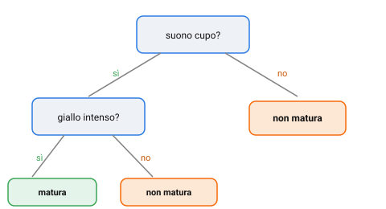

{:class="aside-image"}

### 3.1 Indovina chi, ma per angurie

Conosci di sicuro il meccanismo di "Indovina chi?": si tratta di un gioco da tavola e lo scopo del gioco è trovare una persona particolare in un gruppo di persone. A tal fine il giocatore può fare delle domande: "porta gli occhiali?", "ha i capelli scuri?". Ogni domanda permette al giocatore di avvicinarsi ad indovinare il personaggio permettendogli di scartare, in una situazione ideale, circa la metà dell'insieme delle persone. Poche domande, ben scelte, permettono al giocatore di arrivare alla soluzione in modo molto più veloce che non provando ad indovinare a caso.

Un **albero decisionale** applica esattamente questa stessa logica alla classificazione di angurie, email o clienti: invece di guardare tutti gli indizi insieme come faceva k-NN nella Lezione 2, pone una sequenza di domande semplici, una alla volta, ciascuna con risposta sì/no (o comunque un numero ristretto di risposte), fino ad arrivare a una decisione finale. La differenza fondamentale rispetto a "Indovina chi?" è che qui nessuno sceglie le domande a mano: è l'algoritmo stesso, guardando gli esempi di addestramento, a decidere quali domande porre e in che ordine, proprio come nella Lezione 1, dove la regola nasceva dai dati e non dalla penna del programmatore.

### 3.2 Il vocabolario dell'albero

Un albero decisionale si legge dall'alto verso il basso. Il punto di partenza, in cima, si chiama **nodo radice**: la prima domanda che viene posta a ogni esempio, quella scelta come più utile fra tutte. Da ogni nodo partono dei **rami**, uno per ogni possibile risposta, che portano a un nuovo nodo, una nuova domanda, oppure direttamente a una **foglia**: un nodo finale che non pone più domande, ma restituisce la decisione (nel nostro caso: "matura" o "non matura").

Percorrere l'albero per un esempio nuovo significa semplicemente rispondere, una alla volta, alle domande che incontri partendo dalla radice, seguendo il ramo corrispondente alla tua risposta, finché non atterri su una foglia. La decisione scritta su quella foglia è la previsione del modello.

### 3.3 Come si sceglie la domanda migliore: l'idea di purezza

Il cuore dell'algoritmo, e la parte davvero interessante, è come si decide *quale* domanda porre a ogni nodo, fra tutte quelle possibili. L'idea guida è questa: fra tutte le domande disponibili, scegli quella che divide meglio gli esempi rimasti in gruppi il più possibile **puri**, cioè gruppi dove quasi tutti gli esempi condividono la stessa etichetta.

Facciamo un esempio concreto. Supponi di avere dieci angurie, sei mature e quattro non mature, tutte mischiate insieme in cima all'albero. Confrontiamo due domande candidate:

- La domanda "il suono è cupo?" divide le dieci angurie in due gruppi: uno con 5 mature e 1 non matura, l'altro con 1 matura e 3 non mature. Entrambi i gruppi sono piuttosto **puri**: nel primo dominano nettamente le mature, nel secondo dominano nettamente le non mature.
- La domanda "l'anguria pesa più di 5 kg?" divide invece le stesse dieci angurie in due gruppi quasi identici: 3 mature e 2 non mature da una parte, 3 mature e 2 non mature dall'altra. Entrambi i gruppi restano **mescolati** quasi quanto lo era il gruppo di partenza: la domanda non ha chiarito quasi nulla.

La prima domanda è chiaramente più utile della seconda, perché dopo averla posta sai molto di più su ogni singola anguria di quanto sapessi prima. L'algoritmo prova, in ogni nodo, tutte le domande possibili su tutte le caratteristiche disponibili, misura quanto ciascuna aumenta la purezza dei gruppi risultanti, e sceglie sempre la migliore. Il calcolo esatto che misura la purezza ha un nome tecnico (spesso *impurità di Gini* o *entropia*), ma qui basta tenere a mente l'idea sostanziale: una domanda buona è quella che separa il più possibile gli esempi di etichette diverse.

<figure style="margin: 2rem 0; text-align: center;">
<svg viewBox="0 0 520 260" xmlns="http://www.w3.org/2000/svg" role="img" aria-labelledby="pur-title pur-desc" style="width: 100%; max-width: 480px; height: auto; font-family: inherit;">
  <title id="pur-title">Confronto fra una domanda buona e una domanda inutile</title>
  <desc id="pur-desc">Un gruppo misto di dieci angurie viene diviso da due domande diverse: una produce due gruppi puri, l'altra produce due gruppi ancora mescolati quanto l'originale.</desc>

  <text x="90" y="20" fill="#828282" font-size="11" text-anchor="middle">gruppo di partenza</text>
  <g transform="translate(30,30)">
    <circle cx="0" cy="0" r="6" fill="#3aa655" /><circle cx="16" cy="0" r="6" fill="#3aa655" /><circle cx="32" cy="0" r="6" fill="#3aa655" /><circle cx="48" cy="0" r="6" fill="#c85506" /><circle cx="64" cy="0" r="6" fill="#c85506" />
    <circle cx="0" cy="18" r="6" fill="#3aa655" /><circle cx="16" cy="18" r="6" fill="#3aa655" /><circle cx="32" cy="18" r="6" fill="#3aa655" /><circle cx="48" cy="18" r="6" fill="#c85506" /><circle cx="64" cy="18" r="6" fill="#c85506" />
  </g>

  <text x="230" y="70" fill="#2a7ae2" font-size="12" font-weight="bold" text-anchor="middle">"suono cupo?"</text>
  <path d="M 110,40 L 190,90" fill="none" stroke="#828282" stroke-width="1.5" />
  <path d="M 110,40 L 190,130" fill="none" stroke="#828282" stroke-width="1.5" />

  <g transform="translate(200,80)">
    <circle cx="0" cy="0" r="6" fill="#3aa655" /><circle cx="16" cy="0" r="6" fill="#3aa655" /><circle cx="32" cy="0" r="6" fill="#3aa655" /><circle cx="48" cy="0" r="6" fill="#3aa655" /><circle cx="64" cy="0" r="6" fill="#3aa655" /><circle cx="80" cy="0" r="6" fill="#c85506" />
  </g>
  <text x="330" y="86" fill="#828282" font-size="10">quasi tutto verde: puro</text>

  <g transform="translate(200,120)">
    <circle cx="0" cy="0" r="6" fill="#c85506" /><circle cx="16" cy="0" r="6" fill="#c85506" /><circle cx="32" cy="0" r="6" fill="#c85506" /><circle cx="48" cy="0" r="6" fill="#3aa655" />
  </g>
  <text x="330" y="126" fill="#828282" font-size="10">quasi tutto arancio: puro</text>

  <text x="230" y="175" fill="#c85506" font-size="12" font-weight="bold" text-anchor="middle">"pesa più di 5 kg?"</text>
  <path d="M 110,50 L 190,190" fill="none" stroke="#e3e3e3" stroke-width="1.5" />
  <path d="M 110,50 L 190,230" fill="none" stroke="#e3e3e3" stroke-width="1.5" />

  <g transform="translate(200,180)">
    <circle cx="0" cy="0" r="6" fill="#3aa655" /><circle cx="16" cy="0" r="6" fill="#3aa655" /><circle cx="32" cy="0" r="6" fill="#3aa655" /><circle cx="48" cy="0" r="6" fill="#c85506" /><circle cx="64" cy="0" r="6" fill="#c85506" />
  </g>
  <text x="330" y="186" fill="#828282" font-size="10">ancora mescolato</text>

  <g transform="translate(200,220)">
    <circle cx="0" cy="0" r="6" fill="#3aa655" /><circle cx="16" cy="0" r="6" fill="#3aa655" /><circle cx="32" cy="0" r="6" fill="#3aa655" /><circle cx="48" cy="0" r="6" fill="#c85506" /><circle cx="64" cy="0" r="6" fill="#c85506" />
  </g>
  <text x="330" y="226" fill="#828282" font-size="10">ancora mescolato</text>
</svg>
<figcaption style="color: #828282; font-size: 0.9rem; margin-top: 0.5rem;">Verde = matura, arancio = non matura. La prima domanda separa bene, la seconda quasi per niente.</figcaption>
</figure>

### 3.4 Costruire l'albero: una domanda dopo l'altra

L'algoritmo costruisce l'albero ripetendo lo stesso procedimento a ogni nodo, un livello alla volta. Alla radice, prova tutte le domande possibili su tutte le caratteristiche e sceglie la migliore, dividendo gli esempi nei due gruppi risultanti. Poi, dentro *ciascuno* di quei due gruppi, ripete da capo l'identica ricerca: quale domanda, fra quelle rimaste, separa meglio *questo* sottogruppo specifico? Non è detto sia la stessa domanda usata alla radice, né va posta nello stesso ordine in ogni ramo: ogni sottogruppo può avere la sua domanda più utile, diversa da quella degli altri rami.

Il procedimento si ferma, in un dato ramo, quando un gruppo diventa **completamente puro** (tutti gli esempi rimasti hanno la stessa etichetta: a quel punto non serve più fare domande, si può mettere direttamente una foglia), oppure quando si raggiunge un limite deciso in anticipo, per esempio, non far crescere l'albero oltre una certa profondità, o non dividere più un gruppo che contiene meno di un certo numero di esempi.

Questo secondo tipo di limite non è un dettaglio marginale: un albero lasciato crescere senza freni tende a porre domande sempre più specifiche, fino a isolare un singolo esempio strano in una foglia tutta sua, una domanda così particolare da valere solo per quell'unico caso, inutile per qualunque anguria nuova. Torneremo su questo problema, che ha un nome preciso, nella Lezione 5.

### 3.5 Un pregio degli alberi: si possono leggere

A differenza di k-NN, che non spiega mai *perché* prevede una certa etichetta, si limita a votare fra i vicini, un albero decisionale, una volta costruito, può essere letto e capito riga per riga, esattamente come una ricetta o un diagramma di flusso: "se il suono è cupo e il puntino giallo è pallido, allora non matura". Questa qualità si chiama **interpretabilità**, ed è la ragione per cui gli alberi decisionali restano popolari in settori dove serve poter spiegare una decisione, per esempio, perché una banca ha rifiutato un prestito, non solo prenderla correttamente.

### 3.6 Un albero decisionale in Python

Il programma qui sotto costruisce un albero come descritto nel paragrafo 3.4. Per misurare la purezza usa l'impurità di Gini, il calcolo citato nel paragrafo 3.3, e la funzione `costruisci` chiama se stessa per ripetere la ricerca della domanda migliore dentro ogni gruppo.


# In tutto il programma un esempio è una tupla (scheda, etichetta):
# la scheda è un dizionario con le caratteristiche dell'anguria, per esempio
# ({"suono": "cupo", "giallo": "intenso"}, "sì").

def conta_etichette(esempi):
    """ Conta quante volte compare ogni etichetta.
    parametro esempi: list di tuple (scheda, etichetta)
    return: dict etichetta -> numero di esempi con quell'etichetta
    Esempio: conta_etichette([({"suono": "cupo"}, "sì"), ({"suono": "acuto"}, "no"),
                              ({"suono": "cupo"}, "sì")]) restituisce {"sì": 2, "no": 1}
    """
    conteggi = {}
    for esempio in esempi:
        etichetta = esempio[1]
        if etichetta in conteggi:
            conteggi[etichetta] = conteggi[etichetta] + 1
        else:
            conteggi[etichetta] = 1
    return conteggi

def piu_frequente(esempi):
    """ L'etichetta che compare più volte fra gli esempi.
    parametro esempi: list di tuple (scheda, etichetta)
    return: string, l'etichetta più frequente (a parità, quella vista per prima)
    Esempio: piu_frequente([({"suono": "cupo"}, "sì"), ({"suono": "acuto"}, "no"),
                            ({"suono": "cupo"}, "sì")]) restituisce "sì"
    """
    conteggi = conta_etichette(esempi)
    vincitrice = ""
    for etichetta in conteggi:
        if vincitrice == "" or conteggi[etichetta] > conteggi[vincitrice]:
            vincitrice = etichetta
    return vincitrice

def impurita(esempi):
    """ Impurità di Gini: vale 0 se tutti gli esempi hanno la stessa etichetta,
    e cresce quanto più le etichette sono mescolate.
    Si calcola come 1 meno la somma dei quadrati delle frazioni di ogni etichetta.
    parametro esempi: list di tuple (scheda, etichetta)
    return: float fra 0 e 1
    Esempio: impurita([({"suono": "cupo"}, "sì"), ({"suono": "cupo"}, "sì")]) restituisce 0
    Esempio: impurita([({"suono": "cupo"}, "sì"), ({"suono": "acuto"}, "no")]) restituisce 0.5
    (metà sì e metà no: 1 - (0.5 ** 2 + 0.5 ** 2) = 0.5)
    """
    conteggi = conta_etichette(esempi)
    risultato = 1
    for etichetta in conteggi:
        frazione = conteggi[etichetta] / len(esempi)
        risultato = risultato - frazione ** 2
    return risultato

def dividi(esempi, caratteristica, valore):
    """ Pone una domanda sì/no, per esempio "suono è cupo?", e separa gli esempi.
    parametro esempi: list di tuple (scheda, etichetta)
    parametro caratteristica: string, per esempio "suono"
    parametro valore: string, per esempio "cupo"
    return: tuple di due list: gli esempi che rispondono sì e quelli che rispondono no
    Esempio: dividi([({"suono": "cupo"}, "sì"), ({"suono": "acuto"}, "no")], "suono", "cupo")
             restituisce ([({"suono": "cupo"}, "sì")], [({"suono": "acuto"}, "no")])
    """
    si = []
    no = []
    for esempio in esempi:
        if esempio[0][caratteristica] == valore:
            si.append(esempio)
        else:
            no.append(esempio)
    return si, no

def domanda_migliore(esempi):
    """ Prova tutte le domande possibili e tiene quella che lascia i gruppi più puri.
    parametro esempi: list di tuple (scheda, etichetta)
    return: tuple (caratteristica, valore) della domanda migliore,
            oppure None se nessuna domanda rende i gruppi più puri
    Esempio: domanda_migliore([({"suono": "cupo", "peso": "pesante"}, "sì"),
                               ({"suono": "acuto", "peso": "pesante"}, "no")])
             restituisce ("suono", "cupo")
    (il peso è uguale per entrambe e non aiuta a distinguerle)
    """
    migliore = None
    impurita_minima = impurita(esempi)
    for caratteristica in esempi[0][0]:
        # Raccoglie i valori possibili di questa caratteristica, senza doppioni.
        valori = []
        for esempio in esempi:
            if esempio[0][caratteristica] not in valori:
                valori.append(esempio[0][caratteristica])
        for valore in valori:
            si, no = dividi(esempi, caratteristica, valore)
            # Una domanda che lascia vuoto uno dei due gruppi non divide nulla.
            if len(si) > 0 and len(no) > 0:
                # Media delle due impurità, pesata sulla grandezza dei gruppi.
                impurita_dopo = (len(si) * impurita(si) + len(no) * impurita(no)) / len(esempi)
                if impurita_dopo < impurita_minima:
                    impurita_minima = impurita_dopo
                    migliore = (caratteristica, valore)
    return migliore

def costruisci(esempi, profondita):
    """ Costruisce l'albero: cerca la domanda migliore, divide gli esempi
    e ripete lo stesso procedimento dentro ciascuno dei due gruppi.
    Si ferma se il limite di profondità è raggiunto o se nessuna domanda
    aumenta la purezza: la foglia contiene l'etichetta più frequente.
    parametro esempi: list di tuple (scheda, etichetta)
    parametro profondita: int, quante domande al massimo una dopo l'altra
    return: dict, un nodo dell'albero. Una foglia è {"foglia": etichetta};
            un nodo con una domanda ha le chiavi "caratteristica", "valore",
            "si" e "no", dove "si" e "no" sono a loro volta nodi.
    Esempio: costruisci([({"suono": "cupo"}, "sì"), ({"suono": "acuto"}, "no")], 1)
             restituisce {"caratteristica": "suono", "valore": "cupo",
                          "si": {"foglia": "sì"}, "no": {"foglia": "no"}}
    """
    domanda = None
    if profondita > 0:
        domanda = domanda_migliore(esempi)
    if domanda == None:
        return {"foglia": piu_frequente(esempi)}

    caratteristica, valore = domanda
    si, no = dividi(esempi, caratteristica, valore)
    return {"caratteristica": caratteristica,
            "valore": valore,
            "si": costruisci(si, profondita - 1),
            "no": costruisci(no, profondita - 1)}

def prevedi(nodo, scheda):
    """ Scende dalla radice seguendo le risposte, finché non arriva a una foglia.
    parametro nodo: dict, la radice dell'albero restituito da costruisci
    parametro scheda: dict con le caratteristiche dell'anguria da classificare
    return: string, l'etichetta della foglia raggiunta
    Esempio: prevedi({"caratteristica": "suono", "valore": "cupo",
                      "si": {"foglia": "sì"}, "no": {"foglia": "no"}},
                     {"suono": "acuto"}) restituisce "no"
    """
    while "foglia" not in nodo:
        if scheda[nodo["caratteristica"]] == nodo["valore"]:
            nodo = nodo["si"]
        else:
            nodo = nodo["no"]
    return nodo["foglia"]

def stampa(nodo, rientro):
    """ Un albero si può leggere: lo stampiamo come un diagramma.
    parametro nodo: dict, un nodo dell'albero restituito da costruisci
    parametro rientro: string di spazi messa davanti a ogni riga;
                       si parte da "" e cresce a ogni livello dell'albero
    return: niente, scrive l'albero sul video.
    Per esempio stampa({"caratteristica": "suono", "valore": "cupo",
    "si": {"foglia": "sì"}, "no": {"foglia": "no"}}, "") scrive:
        suono è cupo?
          se sì:
            matura? sì
          se no:
            matura? no
    """
    if "foglia" in nodo:
        print(rientro + "matura? " + nodo["foglia"])
    else:
        print(rientro + nodo["caratteristica"] + " è " + nodo["valore"] + "?")
        print(rientro + "  se sì:")
        stampa(nodo["si"], rientro + "    ")
        print(rientro + "  se no:")
        stampa(nodo["no"], rientro + "    ")

def anguria(suono, giallo, peso, etichetta):
    """ Prepara un esempio, per scrivere la lista delle angurie in modo più corto.
    parametri suono, giallo, peso, etichetta: string
    return: tuple (scheda, etichetta)
    Esempio: anguria("cupo", "intenso", "pesante", "sì")
             restituisce ({"suono": "cupo", "giallo": "intenso", "peso": "pesante"}, "sì")
    """
    return ({"suono": suono, "giallo": giallo, "peso": peso}, etichetta)

angurie = [
    anguria("cupo", "intenso", "pesante", "sì"),
    anguria("cupo", "intenso", "leggero", "sì"),
    anguria("cupo", "intenso", "pesante", "sì"),
    anguria("cupo", "intenso", "leggero", "sì"),
    anguria("cupo", "pallido", "pesante", "no"),
    anguria("cupo", "pallido", "leggero", "no"),
    anguria("acuto", "intenso", "pesante", "no"),
    anguria("acuto", "intenso", "leggero", "no"),
    anguria("acuto", "pallido", "pesante", "no"),
    anguria("acuto", "pallido", "leggero", "no"),
]

# Il limite di profondità, qui 3, è il freno di cui parla il paragrafo 3.4.
albero = costruisci(angurie, 3)
stampa(albero, "")

nuova = {"suono": "cupo", "giallo": "pallido", "peso": "pesante"}
print("Anguria nuova, matura?", prevedi(albero, nuova))


Eseguendo il programma si ottiene:


suono è cupo?
  se sì:
    giallo è intenso?
      se sì:
        matura? sì
      se no:
        matura? no
  se no:
    matura? no
Anguria nuova, matura? no


L'albero ha scelto da solo le domande, e ha ignorato il peso perché su questi esempi non aiuta a separare le etichette. L'albero stampato si legge come una ricetta: è l'interpretabilità di cui parla il paragrafo 3.5.

---

> **Prova tu, Costruisci la radice dell'albero**
>
> Otto angurie, con due caratteristiche a categoria e la loro etichetta:
>
> | Anguria | Suono | Peso | Matura? |
> |---|---|---|---|
> | 1 | cupo | pesante | sì |
> | 2 | cupo | leggero | sì |
> | 3 | cupo | pesante | sì |
> | 4 | cupo | leggero | sì |
> | 5 | acuto | pesante | no |
> | 6 | acuto | leggero | no |
> | 7 | acuto | pesante | no |
> | 8 | acuto | leggero | no |
>
> 1. Se poni la domanda "il suono è cupo?", in quanti gruppi si dividono le otto angurie, e quante mature/non mature finiscono in ciascun gruppo?
> 2. Se poni invece la domanda "il peso è pesante?", quante mature/non mature finiscono in ciascun gruppo?
> 3. Quale delle due domande produce gruppi più puri? Sulla base di questo, quale useresti come domanda alla radice dell'albero?

---

## Esercizi

1. Pensa al gioco "Indovina chi?" (o un gioco simile a domande sì/no che conosci) e descrivi due domande che faresti all'inizio: una che "divide bene" i candidati rimasti, e una inutile perché non separa quasi nulla. Spiega la differenza in termini di purezza.
2. Descrivi, anche solo a parole, un piccolo albero decisionale a due livelli per decidere se portare l'ombrello, usando come caratteristiche "cielo nuvoloso?" e "hai sentito le previsioni?". Indica chiaramente radice, rami e foglie.
3. Perché un albero decisionale è considerato più "interpretabile" di k-NN? Fai un esempio di un contesto reale, diverso da quello del prestito bancario citato nel testo, in cui questa interpretabilità sarebbe particolarmente importante.
4. Spiega cosa succede, in linea di principio, se si lascia crescere un albero decisionale senza alcun limite di profondità su un insieme di addestramento con qualche esempio anomalo o etichettato per errore.
5. Immagina un gruppo di dieci studenti, sei promossi e quattro no, con due caratteristiche: "ha consegnato tutti i compiti?" e "porta gli occhiali?". Spiega, senza fare calcoli precisi, quale delle due pensi sarebbe una domanda migliore per il nodo radice, e perché.

---

*Continua con la [Lezione 04, Tracciare la retta migliore]({{ site.baseurl }}.html)*
