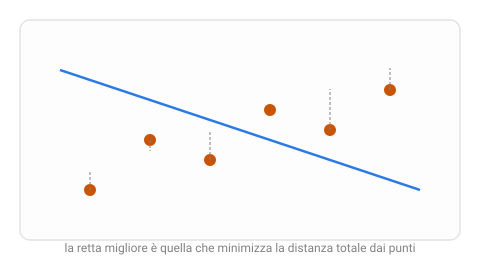

{:class="aside-image"}

### 4.1 Non più sì o no, ma un numero

Le lezioni 2 e 3 hanno affrontato un solo tipo di domanda: **l'anguria è matura o non matura**, **sì o no**. Ma moltissime domande interessanti hanno una risposta che non consiste in un valore booleano (Vero o Falso) ma si risolve in una grandezza misurabile e descrivibile attraverso un **numero**: quanto vale una bicicletta usata? Quanti gradi di temperatura ci saranno domani alle 8 del mattino? Quanto tempo impiegherà un pacco ad arrivare? Prevedere un numero, invece di scegliere fra un gruppo ristretto di categorie, si chiama **regressione**, l'abbiamo già nominata nella Lezione 1, ed è ora di vedere come funziona davvero.

Prendiamo un esempio concreto: vuoi stimare il prezzo giusto per rivendere una bicicletta usata, e l'unico indizio che hai è la sua età in anni. Hai a disposizione i prezzi a cui altre biciclette simili sono state vendute di recente, in funzione della loro età: una specie di listino osservato, non scritto da nessuno a priori.

### 4.2 I punti sparsi e la retta che li attraversa

Se disegni ogni bicicletta venduta come un punto su un grafico, età sull'asse orizzontale, prezzo di vendita su quello verticale, otterrai una nuvola di punti sparsi, non allineati con precisione ma con una tendenza chiara: le biciclette più vecchie, in generale, valgono meno. Questo tipo di grafico si chiama **grafico a dispersione**.

L'idea più semplice di regressione è tracciare, in mezzo a questa nuvola di punti, una singola linea retta che li rappresenti il più fedelmente possibile: non un'equazione trovata a tavolino da un esperto di biciclette, ma una linea trovata automaticamente a partire proprio da quei punti, la **regressione lineare**. Una volta tracciata questa retta, prevedere il prezzo di una bicicletta nuova, di cui conosci solo l'età, diventa semplicissimo: guardi dove quell'età cade sull'asse orizzontale, sali fino alla retta, e leggi il prezzo corrispondente sull'asse verticale.

### 4.3 Cosa rende una retta "migliore" di un'altra

Il problema, naturalmente, è che infinite rette diverse potrebbero attraversare più o meno la stessa nuvola di punti. Come si sceglie quella giusta? L'idea alla base è misurare, per ciascuna retta candidata, quanto "sbaglia" in totale rispetto ai punti reali, e scegliere quella che sbaglia di meno.

Per ogni punto della nuvola, la distanza verticale fra il punto e la retta, quanto il prezzo osservato si discosta dal prezzo previsto dalla retta per quella stessa età, è l'**errore** commesso su quel singolo esempio. Sommando (con un piccolo accorgimento) gli errori commessi su tutti i punti della nuvola, si ottiene un unico numero complessivo che misura quanto quella particolare retta si adatta bene ai dati: più questo numero è basso, meglio la retta rappresenta la nuvola di punti nel suo complesso.

L'accorgimento a cui accennavamo è questo: invece di sommare semplicemente le distanze così come sono, di solito si sommano le distanze *elevate al quadrato*. L'effetto pratico è che un errore grande pesa molto più che proporzionalmente rispetto a un errore piccolo: sbagliare di 100 euro su una singola bicicletta pesa molto più di dieci volte lo sbagliare di 10 euro. Questo scoraggia rette che vanno benissimo sulla maggior parte dei punti ma sbagliano clamorosamente su pochi casi, a favore di rette che restano ragionevolmente vicine a tutti i punti, senza eccezioni troppo gravi. Questo numero complessivo, che riassume quanto un modello sbaglia su tutti gli esempi insieme, ha un nome che ritroverai spesso anche fuori da questo libro: si chiama **funzione di perdita** (in inglese *loss*, letteralmente "perdita", quanto stai perdendo, in accuratezza, con questa retta specifica).

<figure style="margin: 2rem 0; text-align: center;">
<svg viewBox="0 0 520 240" xmlns="http://www.w3.org/2000/svg" role="img" aria-labelledby="due-title due-desc" style="width: 100%; max-width: 480px; height: auto; font-family: inherit;">
  <title id="due-title">Due rette candidate sulla stessa nuvola di punti</title>
  <desc id="due-desc">Lo stesso gruppo di punti attraversato da due rette diverse: una passa vicino a quasi tutti i punti, l'altra si allontana molto da alcuni di essi.</desc>

  <text x="130" y="20" fill="#3aa655" font-size="12" font-weight="bold" text-anchor="middle">retta A, errore totale basso</text>
  <rect x="20" y="30" width="220" height="150" fill="none" stroke="#e3e3e3" stroke-width="1" />
  <line x1="35" y1="150" x2="225" y2="55" stroke="#3aa655" stroke-width="2.5" />
  <g fill="#c85506">
    <circle cx="50" cy="145" r="5" /><circle cx="90" cy="120" r="5" /><circle cx="130" cy="105" r="5" /><circle cx="170" cy="80" r="5" /><circle cx="210" cy="65" r="5" />
  </g>

  <text x="390" y="20" fill="#c85506" font-size="12" font-weight="bold" text-anchor="middle">retta B, errore totale alto</text>
  <rect x="280" y="30" width="220" height="150" fill="none" stroke="#e3e3e3" stroke-width="1" />
  <line x1="295" y1="170" x2="485" y2="45" stroke="#c85506" stroke-width="2.5" />
  <g fill="#c85506">
    <circle cx="310" cy="145" r="5" /><circle cx="350" cy="120" r="5" /><circle cx="390" cy="105" r="5" /><circle cx="430" cy="80" r="5" /><circle cx="470" cy="65" r="5" />
  </g>

  <text x="130" y="200" fill="#828282" font-size="11" text-anchor="middle">passa vicino a tutti i punti</text>
  <text x="390" y="200" fill="#828282" font-size="11" text-anchor="middle">sbaglia parecchio su quasi ogni punto</text>
</svg>
<figcaption style="color: #828282; font-size: 0.9rem; margin-top: 0.5rem;">Stessa nuvola di punti, due rette diverse: la funzione di perdita permette di dire quale delle due è oggettivamente migliore.</figcaption>
</figure>

### 4.4 Come si trova la retta migliore

A questo punto resta un'ultima domanda: fra le infinite rette possibili, come fa l'algoritmo a trovare proprio quella con l'errore totale più basso, senza doverle provare letteralmente tutte a una a una?

Per il caso di una sola caratteristica in ingresso (solo l'età, come nel nostro esempio), esiste un modo di calcolare direttamente la retta migliore in un unico passaggio, senza tentativi, un po' come esiste una formula diretta per trovare il centro esatto di un cerchio che passa per tre punti dati, invece di doverlo cercare per approssimazioni successive. Ma quando le caratteristiche in ingresso diventano tante, età, chilometraggio, marca, numero di marce, tutte insieme, questo calcolo diretto diventa via via più pesante, e si preferisce spesso un approccio diverso, per tentativi: si parte da una retta scelta a caso, si misura il suo errore totale, e la si aggiusta leggermente, un po' alla volta, nella direzione che fa scendere l'errore, un pizzico di inclinazione in più, un pizzico di altezza in meno, ripetendo la correzione finché l'errore smette di migliorare in modo apprezzabile.

Questo secondo approccio, per piccoli aggiustamenti ripetuti, potrebbe suonarti familiare: è la stessa identica logica di correzione-per-tentativi-ripetuti del percettrone che apre *Come Pensano le Reti Neurali*, non è un caso. Il concetto di "funzione di perdita da minimizzare correggendo un po' alla volta" è uno dei fili conduttori più importanti di tutto il machine learning, che ritroverai, sotto forme via via più elaborate, in quasi ogni modello che incontrerai, incluse le reti neurali.

### 4.5 Oltre una sola caratteristica

Il nostro esempio ha usato una sola caratteristica, l'età, ma quasi nessun problema reale si accontenta di un solo indizio. Il prezzo di una bicicletta dipende anche dal chilometraggio, dalla marca, dallo stato dei freni. Quando le caratteristiche in ingresso sono più di una, il principio resta identico, trovare la combinazione di pesi, uno per ogni caratteristica, che minimizza l'errore totale sui dati noti, ma non si parla più di una singola "retta" su un grafico bidimensionale: con due caratteristiche il modello traccia un intero **piano** inclinato in uno spazio a tre dimensioni, e con più caratteristiche ancora una superficie che nessun disegno riesce più a mostrare direttamente. La logica di fondo, però, non cambia di una virgola rispetto al caso con una sola caratteristica: si chiama **regressione lineare multipla**, ed è semplicemente la stessa idea applicata a più indizi contemporaneamente.

### 4.6 La retta migliore in Python

Il programma trova la retta migliore nei due modi descritti nel paragrafo 4.4: con il calcolo diretto e per piccoli aggiustamenti ripetuti. La funzione `perdita` è la somma degli errori al quadrato del paragrafo 4.3.


# In tutto il programma un esempio è una tupla (età, prezzo),
# per esempio (2, 270): una bicicletta di 2 anni venduta a 270 euro.
# La retta "prezzo = inclinazione * età + altezza" è descritta da due numeri.

def perdita(esempi, inclinazione, altezza):
    """ Funzione di perdita: somma degli errori elevati al quadrato.
    parametro esempi: list di tuple (età, prezzo)
    parametro inclinazione: float, di quanto cambia il prezzo per ogni anno
    parametro altezza: float, il prezzo previsto per una bicicletta nuova
    return: float, più è piccola, più la retta passa vicino agli esempi
    Esempio: perdita([(1, 310), (2, 270)], -40, 350) restituisce 0
    (la retta passa esattamente per entrambi i punti)
    Esempio: perdita([(1, 310), (2, 270)], -30, 330) restituisce 100
    (la retta prevede 300 e 270, gli errori sono 10 e 0: 10 ** 2 + 0 ** 2 = 100)
    """
    somma = 0
    for esempio in esempi:
        eta, prezzo = esempio
        errore = prezzo - (inclinazione * eta + altezza)
        somma = somma + errore ** 2
    return somma

def retta_diretta(esempi):
    """ Il calcolo diretto, possibile con una sola caratteristica:
    trova la retta migliore in un unico passaggio, senza tentativi.
    parametro esempi: list di tuple (età, prezzo)
    return: tuple (inclinazione, altezza) della retta migliore
    Esempio: retta_diretta([(1, 310), (2, 270), (3, 230)]) restituisce (-40.0, 350.0)
    """
    somma_eta = 0
    somma_prezzi = 0
    for esempio in esempi:
        eta, prezzo = esempio
        somma_eta = somma_eta + eta
        somma_prezzi = somma_prezzi + prezzo
    media_eta = somma_eta / len(esempi)
    media_prezzo = somma_prezzi / len(esempi)

    sopra = 0
    sotto = 0
    for esempio in esempi:
        eta, prezzo = esempio
        sopra = sopra + (eta - media_eta) * (prezzo - media_prezzo)
        sotto = sotto + (eta - media_eta) ** 2
    inclinazione = sopra / sotto
    # La retta migliore passa sempre dal punto medio della nuvola.
    altezza = media_prezzo - inclinazione * media_eta
    return inclinazione, altezza

def retta_per_tentativi(esempi, passo, giri):
    """ Parte da una retta qualsiasi e la corregge un po' alla volta.
    parametro esempi: list di tuple (età, prezzo)
    parametro passo: float, quanto è grande ogni correzione, per esempio 0.01
    parametro giri: int, quante correzioni fare, per esempio 20000
    return: tuple (inclinazione, altezza), vicina alla retta migliore
    se il passo è abbastanza piccolo e i giri abbastanza numerosi
    Esempio: retta_per_tentativi([(1, 310), (2, 270), (3, 230)], 0.01, 20000)
             restituisce circa (-40, 350)
    """
    inclinazione = 0.0
    altezza = 0.0
    for giro in range(giri):
        # Calcola in che direzione cambiare i due valori per far scendere la perdita.
        verso_inclinazione = 0.0
        verso_altezza = 0.0
        for esempio in esempi:
            eta, prezzo = esempio
            errore = prezzo - (inclinazione * eta + altezza)
            verso_inclinazione = verso_inclinazione + errore * eta
            verso_altezza = verso_altezza + errore
        # Il passo piccolo evita di scavalcare la soluzione con correzioni troppo grandi.
        inclinazione = inclinazione + passo * verso_inclinazione / len(esempi)
        altezza = altezza + passo * verso_altezza / len(esempi)
    return inclinazione, altezza

# Ogni esempio è una coppia: età in anni e prezzo di vendita in euro.
biciclette = [(1, 310), (2, 270), (3, 255), (5, 190), (6, 170), (8, 100)]

# round(valore, 2) arrotonda alla seconda cifra decimale.
inclinazione, altezza = retta_diretta(biciclette)
print("Calcolo diretto: prezzo =", round(altezza, 2), round(inclinazione, 2), "x età")
print("Perdita:", round(perdita(biciclette, inclinazione, altezza), 2))

# Un passo di 0.01 ripetuto per 20000 giri.
inclinazione2, altezza2 = retta_per_tentativi(biciclette, 0.01, 20000)
print("Per tentativi:   prezzo =", round(altezza2, 2), round(inclinazione2, 2), "x età")
print("Perdita:", round(perdita(biciclette, inclinazione2, altezza2), 2))

# Per fare una previsione basta leggere la retta in corrispondenza dell'età.
print("Bicicletta di 4 anni:", round(inclinazione * 4 + altezza, 2), "euro")


Eseguendo il programma si ottiene:


Calcolo diretto: prezzo = 336.75 -29.02 x età
Perdita: 187.32
Per tentativi:   prezzo = 336.75 -29.02 x età
Perdita: 187.32
Bicicletta di 4 anni: 220.67 euro


Le due strade arrivano alla stessa retta e quindi alla stessa perdita: ogni anno di età toglie circa 29 euro al prezzo. Il metodo per tentativi ha però bisogno di due scelte in più, l'ampiezza del passo e il numero di giri, e di molte più operazioni: con una sola caratteristica il calcolo diretto è più comodo, ma è l'idea dei tentativi quella che ritroverai nelle reti neurali.

---

> **Prova tu, Confronta due regole di prezzo**
>
> Hai osservato queste quattro biciclette usate, con la loro età (in anni) e il prezzo a cui sono state vendute:
>
> | Bicicletta | Età | Prezzo reale |
> |---|---|---|
> | 1 | 1 | 180 € |
> | 2 | 2 | 150 € |
> | 3 | 4 | 130 € |
> | 4 | 5 | 90 € |
>
> Due regole candidate, ciascuna una semplice retta:
>
> - **Regola A**: prezzo previsto = 190 − 20 × età
> - **Regola B**: prezzo previsto = 170 − 15 × età
>
> 1. Calcola il prezzo previsto dalla Regola A per ciascuna delle quattro biciclette, e l'errore (differenza fra prezzo reale e prezzo previsto) per ciascuna.
> 2. Fai lo stesso per la Regola B.
> 3. Sommando gli errori in valore assoluto (cioè ignorando se sono positivi o negativi) di ciascuna regola, quale delle due ha l'errore totale più basso, e quindi rappresenta meglio questi dati?

---

## Esercizi

1. Pensa a un problema di regressione diverso da quello delle biciclette (per esempio, prevedere il tempo di consegna di un pacco, il consumo di benzina di un'auto, il voto di un tema in base al numero di pagine scritte). Descrivi quale caratteristica useresti e che forma ti aspetteresti abbia la relazione, crescente o decrescente.
2. Spiega perché sommare gli errori al quadrato, invece di sommarli così come sono, penalizza di più le rette che sbagliano molto su pochi punti piuttosto che quelle che sbagliano un po' su tutti.
3. Descrivi, anche solo a parole, una nuvola di cinque punti e due rette candidate diverse: una che passa vicino a tutti i punti, una che si allontana molto da uno di essi. Quale delle due avrebbe una funzione di perdita più bassa?
4. Nella Sezione 4.5 si parla di regressione lineare multipla, che usa più caratteristiche insieme. Elenca almeno tre caratteristiche che potresti usare, oltre all'età, per prevedere il prezzo di una bicicletta usata, e spiega brevemente perché ciascuna potrebbe essere utile.
5. Un amico ti mostra una retta di regressione che passa esattamente su ogni singolo punto del suo insieme di addestramento, con errore totale pari a zero. Dovresti essere impressionato o preoccupato? Prova a motivare la tua risposta, anche solo intuitivamente (la Lezione 5 approfondirà questo punto).

---

*Continua con la [Lezione 05, Memorizzare non è capire]({{ site.baseurl }}.html)*
