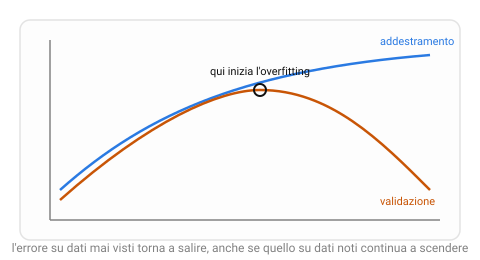

{:class="aside-image"}

### 5.1 Le tremila domande a memoria

Immagina uno studente che deve prepararsi per il quiz di teoria della patente. Trova online l'elenco completo delle tremila domande ufficiali con le relative risposte, e passa le settimane successive a memorizzarle una per una, parola per parola. Il giorno dell'esame, se le domande sono esattamente quelle studiate, risponde a tutto correttamente: sembra un genio del codice della strada.

Ma mettiamolo alla guida vera, su una strada reale, davanti a una situazione che nessuna delle tremila domande descriveva esattamente, un cartello coperto da un ramo, un incrocio con una segnaletica inconsueta. Se non ha mai davvero capito *perché* certe regole esistono, e si è limitato a far corrispondere domande a risposte memorizzate, andrà in difficoltà. Ha imparato le tremila domande, non il codice della strada.

Questo è precisamente il rischio più insidioso di ogni modello di machine learning, ed è il motivo per cui questa lezione arriva proprio ora, dopo aver visto tre algoritmi diversi (k-NN, alberi decisionali, regressione lineare) che condividono tutti lo stesso pericolo.

### 5.2 Overfitting: quando il modello memorizza invece di generalizzare

Un modello che si comporta come lo studente delle tremila domande, perfetto sugli esempi già visti, ma scadente su casi nuovi mai incontrati prima, soffre di **overfitting** (letteralmente, "sovra-adattamento"): si è adattato talmente bene ai dati di addestramento, comprese le loro particolarità casuali e il rumore, da aver smesso di catturare la regola generale sottostante, e aver iniziato invece a memorizzare i casi specifici.

Torniamo agli algoritmi delle lezioni precedenti per vedere come l'overfitting si manifesta concretamente in ciascuno.

In **k-NN** (Lezione 2), un valore di k troppo piccolo, in particolare k = 1, fa sì che ogni previsione dipenda da un singolo esempio noto: un'anguria etichettata per errore, o semplicemente anomala, "contagia" ogni punto nuovo che le capita vicino, anche se non rappresenta affatto la tendenza generale della zona.

In un **albero decisionale** (Lezione 3), un albero lasciato crescere senza limiti finisce per porre domande sempre più specifiche, fino a isolare un singolo esempio strano dentro una foglia tutta sua, una regola così particolare da valere solo per quell'unico caso, priva di qualunque valore predittivo su un esempio nuovo.

Nella **regressione lineare** (Lezione 4), l'overfitting è meno immediato con una sola retta, ma diventa evidente non appena si permettono curve più elaborate di una semplice linea retta: una curva abbastanza flessibile può essere piegata fino a passare esattamente su ogni singolo punto noto, ma nel farlo comincia a serpeggiare in modo assurdo fra un punto e l'altro, inseguendo il rumore casuale dei dati invece della tendenza reale.

### 5.3 Underfitting: l'altro estremo

Esiste anche l'errore opposto. Uno studente che, invece di studiare le tremila domande, si limitasse a leggere una sola pagina riassuntiva troppo generica ("guida con prudenza") non sarebbe pronto nemmeno per le domande più elementari dell'esame: non ha memorizzato troppo, ha semplicemente imparato troppo poco.

Un modello che si comporta così, k troppo grande in k-NN (che finisce per prevedere sempre la stessa etichetta più comune, ignorando ogni indizio locale), un albero fermato dopo una sola domanda, una retta forzata su dati che seguono in realtà un andamento curvo, soffre di **underfitting** (letteralmente, "sotto-adattamento"): è troppo semplice per catturare nemmeno i pattern più evidenti già presenti negli esempi di addestramento, figuriamoci quelli su dati nuovi.

Il segno distintivo che separa i due problemi è dove si manifesta l'errore. Nell'underfitting, il modello sbaglia parecchio *anche* sugli esempi che ha già visto durante l'addestramento, non ha imparato bene nemmeno quelli. Nell'overfitting, il modello va benissimo sugli esempi già visti (a volte alla perfezione) ma sbaglia parecchio su esempi nuovi, ha imparato quelli a memoria, non la regola generale che li collega.

### 5.4 Come scoprire quale dei due sta succedendo: dividere i dati

Il problema pratico è che, guardando solo l'errore sugli esempi di addestramento, overfitting e "modello perfetto" sono indistinguibili: entrambi mostrano un errore bassissimo su quei dati. Serve un modo per misurare, separatamente, quanto il modello si comporta bene su dati che non ha mai visto durante l'apprendimento, proprio come lo studente andrebbe davvero testato con domande mai incontrate prima, non con le stesse tremila già studiate a memoria.

La soluzione standard è dividere fin dall'inizio gli esempi disponibili in due gruppi separati, tenuti rigorosamente distinti per tutto il processo:

- L'**insieme di addestramento** (*training set*), su cui il modello viene effettivamente costruito, le domande che lo studente studia.
- L'**insieme di test**, tenuto completamente da parte, mai mostrato al modello durante l'addestramento, usato solo alla fine per misurare quanto il modello se la cava su casi davvero nuovi, l'esame vero, con domande mai viste.

Una regola pratica comune è usare circa l'80% degli esempi disponibili per l'addestramento e il restante 20% per il test, scelti a caso in modo che entrambi i gruppi siano rappresentativi dell'insieme originale. Il numero esatto non è sacro, dipende da quanti dati hai a disposizione in totale, ma il principio di tenerli separati sì, sempre.

Spesso si usa in realtà una terza suddivisione, l'**insieme di validazione**: un secondo gruppo, distinto sia dal training che dal test, usato durante lo sviluppo per confrontare più modelli o più impostazioni (per esempio, provare diversi valori di k) senza mai toccare l'insieme di test, che resta riservato a una verifica finale, una sola volta, quando ogni decisione è già stata presa. Usare l'insieme di test troppe volte per aggiustare le proprie scelte, infatti, rischia di farlo diventare, di fatto, un secondo insieme di addestramento, annullandone lo scopo.

### 5.5 La curva della complessità

Mettendo insieme quanto visto, emerge un quadro utile per qualunque algoritmo di questo libro: al crescere della **complessità** del modello, k sempre più piccolo, albero sempre più profondo, curva sempre più flessibile, l'errore sull'insieme di addestramento scende quasi sempre, con costanza, fino quasi ad annullarsi. L'errore sull'insieme di validazione, invece, scende all'inizio (il modello sta davvero imparando la regola generale), ma da un certo punto in poi torna a salire (il modello ha smesso di generalizzare e ha iniziato a memorizzare le particolarità dell'insieme di addestramento).

Il punto in cui l'errore di validazione smette di scendere e comincia a risalire indica, approssimativamente, il livello di complessità giusto per quel problema specifico: né così semplice da sotto-adattare, né così complesso da sovra-adattare. Trovare questo punto, spesso provando diverse impostazioni e confrontando l'errore di validazione, è una delle attività più concrete e ricorrenti di chi costruisce modelli di machine learning nella pratica.

### 5.6 Vedere l'overfitting in Python

Possiamo osservare overfitting e underfitting con il k-NN della Lezione 2. Il programma crea 500 angurie inventate, con una parte di etichette sbagliate apposta, le divide in addestramento e test, e misura l'errore sui due insiemi per diversi valori di k.


import random

# In tutto il programma un esempio è una tupla ((suono, giallo), etichetta),
# per esempio ((8.2, 7.5), "sì"), come nella Lezione 2.

def valore_assoluto(numero):
    """ Il valore assoluto è il numero senza segno.
    parametro numero: int o float
    return: int o float, il numero reso positivo
    Esempio: valore_assoluto(-2.5) restituisce 2.5
    """
    if numero < 0:
        return -numero
    return numero

def distanza(a, b):
    """ La stessa distanza della Lezione 2.
    parametri a, b: tuple (suono, giallo)
    return: int o float, la somma delle differenze senza segno
    Esempio: distanza((8, 7), (3, 4)) restituisce 8
    """
    return valore_assoluto(a[0] - b[0]) + valore_assoluto(a[1] - b[1])

def etichette_in_ordine(esempi, nuovo):
    """ Mette in ordine gli esempi dal più vicino al più lontano dal punto nuovo.
    Ogni esempio viene aggiunto in fondo e poi fatto scivolare indietro
    finché quello che lo precede non è più vicino di lui.
    parametro esempi: list di tuple ((suono, giallo), etichetta)
    parametro nuovo: tuple (suono, giallo)
    return: list delle etichette, dalla più vicina alla più lontana
    Esempio: etichette_in_ordine([((8, 7), "sì"), ((2, 3), "no"), ((9, 8), "sì")], (3, 4))
             restituisce ["no", "sì", "sì"]
    """
    distanze = []
    etichette = []
    for esempio in esempi:
        distanze.append(distanza(esempio[0], nuovo))
        etichette.append(esempio[1])
        i = len(distanze) - 1
        while i > 0 and distanze[i - 1] > distanze[i]:
            temp = distanze[i]
            distanze[i] = distanze[i - 1]
            distanze[i - 1] = temp
            temp = etichette[i]
            etichette[i] = etichette[i - 1]
            etichette[i - 1] = temp
            i = i - 1
    return etichette

def piu_votata(etichette):
    """ Lo stesso conteggio dei voti della Lezione 2.
    parametro etichette: list di string
    return: string, l'etichetta più frequente (a parità, quella vista per prima)
    Esempio: piu_votata(["sì", "no", "no"]) restituisce "no"
    """
    voti = {}
    for etichetta in etichette:
        if etichetta in voti:
            voti[etichetta] = voti[etichetta] + 1
        else:
            voti[etichetta] = 1
    vincitrice = ""
    for etichetta in voti:
        if vincitrice == "" or voti[etichetta] > voti[vincitrice]:
            vincitrice = etichetta
    return vincitrice

def errori(addestramento, valutati, valori_di_k):
    """ Misura, per ogni k, quanto spesso sbaglia il k-NN.
    Gli esempi vengono messi in ordine di distanza una volta sola,
    poi per ogni k basta far votare i primi k.
    parametro addestramento: list di esempi che il modello tiene in memoria
    parametro valutati: list di esempi su cui misurare gli errori
    parametro valori_di_k: list di int, per esempio [1, 3, 15]
    return: dict k -> percentuale di esempi valutati classificati male
    Esempio: errori([((8, 7), "sì"), ((2, 3), "no")],
                    [((9, 8), "sì"), ((1, 1), "sì")], [1]) restituisce {1: 50.0}
    (il punto (1, 1) è vicino a un "no" ma la sua etichetta è "sì")
    """
    sbagliati = {}
    for k in valori_di_k:
        sbagliati[k] = 0
    for esempio in valutati:
        punto, etichetta = esempio
        vicini = etichette_in_ordine(addestramento, punto)
        for k in valori_di_k:
            if piu_votata(vicini[:k]) != etichetta:
                sbagliati[k] = sbagliati[k] + 1
    percentuali = {}
    for k in valori_di_k:
        percentuali[k] = 100 * sbagliati[k] / len(valutati)
    return percentuali

def crea_angurie(quante):
    """ Inventa delle angurie: sono mature se suono + giallo supera 10,
    ma il 20% delle etichette viene invertito, come il rumore dei dati reali.
    parametro quante: int, quante angurie creare
    return: list di tuple ((suono, giallo), etichetta) con numeri fra 0 e 10.
    Il risultato dipende dal caso: per esempio crea_angurie(2) potrebbe
    restituire [((6.4, 0.3), "no"), ((2.8, 9.1), "sì")]
    """
    angurie = []
    for i in range(quante):
        # random.random() restituisce un numero a caso fra 0 e 1:
        # moltiplicato per 10 diventa un voto fra 0 e 10.
        suono = random.random() * 10
        giallo = random.random() * 10
        if suono + giallo > 10:
            etichetta = "sì"
        else:
            etichetta = "no"
        if random.random() < 0.20:
            if etichetta == "sì":
                etichetta = "no"
            else:
                etichetta = "sì"
        angurie.append(((suono, giallo), etichetta))
    return angurie

# Fissare il seme rende i numeri casuali sempre uguali a ogni esecuzione.
random.seed(6)
angurie = crea_angurie(500)

# Le angurie sono già in ordine casuale: le prime 400 (l'80%) servono
# per l'addestramento, le ultime 100 (il 20%) per il test.
addestramento = angurie[:400]
test = angurie[400:]

valori_di_k = [1, 3, 15, 51, 201, 400]
# Il test dice la verità: l'errore di addestramento da solo inganna.
errori_addestramento = errori(addestramento, addestramento, valori_di_k)
errori_test = errori(addestramento, test, valori_di_k)
for k in valori_di_k:
    print("k = " + str(k) + ": addestramento " + str(round(errori_addestramento[k], 1))
          + "%, test " + str(round(errori_test[k], 1)) + "%")


Eseguendo il programma si ottiene:


k = 1: addestramento 0.0%, test 33.0%
k = 3: addestramento 18.5%, test 30.0%
k = 15: addestramento 23.2%, test 24.0%
k = 51: addestramento 26.0%, test 26.0%
k = 201: addestramento 26.5%, test 28.0%
k = 400: addestramento 49.5%, test 51.0%


I numeri raccontano la lezione. Con k = 1 l'errore di addestramento è zero, perché ogni anguria ha come vicina più prossima se stessa, ma l'errore di test è il peggiore fra i valori piccoli di k: è l'overfitting. Con k = 400, cioè tutto l'insieme, il modello vota sempre l'etichetta più comune e sbaglia circa una volta su due su entrambi gli insiemi: è l'underfitting. L'errore di test più basso sta nel mezzo, attorno a k = 15. A rigore, per scegliere k andrebbe usato un insieme di validazione, come spiegato nel paragrafo 5.4: qui guardiamo il test solo per vedere il fenomeno.

---

> **Prova tu, Diagnostica due modelli**
>
> Due modelli sono stati addestrati sullo stesso problema di classificazione di angurie. Ecco il loro errore (in percentuale di angurie classificate male, quindi più basso è meglio) sull'insieme di addestramento e sull'insieme di test:
>
> | Modello | Errore addestramento | Errore test |
> |---|---|---|
> | Modello X | 1% | 34% |
> | Modello Y | 28% | 31% |
>
> 1. Il Modello X ha un errore bassissimo sui dati di addestramento, ma molto più alto sul test. Come si chiama questo problema, e cosa suggerisce sul comportamento del modello?
> 2. Il Modello Y ha un errore alto sia sull'addestramento sia sul test, con un divario molto più piccolo fra i due. Come si chiama questo secondo problema?
> 3. Nessuno dei due modelli è ideale. Descrivi con parole tue cosa dovrebbe mostrare l'errore di un terzo modello, "Modello Z", perché tu possa dire che ha trovato il giusto equilibrio.

---

## Esercizi

1. Racconta, con parole tue, un esempio di overfitting tratto dalla vita reale, diverso da quello dello studente delle tremila domande, per esempio uno studente che impara a memoria le soluzioni di un libro di esercizi senza capire il procedimento.
2. Spiega la differenza fra insieme di addestramento, insieme di validazione e insieme di test, e perché usare l'insieme di test troppe volte durante lo sviluppo rischia di comprometterne l'utilità.
3. Un modello ha l'1% di errore sull'insieme di addestramento e il 2% sull'insieme di test. Un secondo modello ha il 15% di errore sull'insieme di addestramento e il 16% sul test. Quale dei due preferiresti usare, e quale problema, fra overfitting e underfitting, pensi che nessuno dei due stia mostrando in modo grave?
4. Descrivi, per ciascuno dei tre algoritmi visti nelle Lezioni 2, 3 e 4 (k-NN, alberi decisionali, regressione lineare), una scelta concreta che, se esagerata, porta più facilmente a overfitting.
5. Spiega con parole tue cosa rappresenta il punto in cui la curva dell'errore di validazione smette di scendere e ricomincia a salire, e perché quel punto è utile per scegliere la complessità giusta di un modello.

---

*Continua con la [Lezione 06, Quanto è bravo, davvero?]({{ site.baseurl }}.html)*
