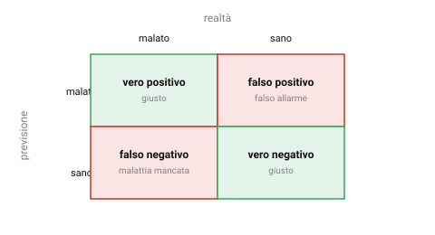

{:class="aside-image"}

### 6.1 Un modello che ha ragione il 99% delle volte

Immagina un modello pensato per individuare una malattia rara, che colpisce circa una persona su cento, a partire da alcuni esami del sangue. Un collega ti annuncia con entusiasmo di aver costruito un modello che ha ragione nel 99% dei casi. Sembra un risultato eccezionale, finché non scopri che il modello, in realtà, si limita a dire sempre "sano", per chiunque, senza nemmeno guardare gli esami.

Dato che solo una persona su cento è davvero malata, un modello che dice sempre "sano" ha ragione esattamente nel 99% dei casi, sbagliando però ogni singola volta che conta davvero, cioè su ogni paziente effettivamente malato. Questo modello non serve a nulla, eppure la sua **accuratezza** (la percentuale di previsioni corrette sul totale) è altissima. Questa lezione spiega perché l'accuratezza, da sola, può ingannare, e cosa guardare al suo posto.

### 6.2 La matrice di confusione: quattro modi di avere ragione o torto

Per capire davvero come si comporta un modello di classificazione, non basta un unico numero: serve distinguere fra i diversi *tipi* di errore che può commettere. Per un problema con due sole categorie, malato/sano, spam/non spam, esistono quattro combinazioni possibili fra ciò che il modello prevede e ciò che è vero:

- **Vero positivo**: il modello dice "malato", ed effettivamente lo è. Ha ragione.
- **Vero negativo**: il modello dice "sano", ed effettivamente lo è. Ha ragione.
- **Falso positivo**: il modello dice "malato", ma in realtà è sano. Un falso allarme.
- **Falso negativo**: il modello dice "sano", ma in realtà è malato. Una malattia mancata.

Organizzare il conteggio di questi quattro casi in una tabella due per due si chiama **matrice di confusione**, ed è lo strumento di base per capire cosa sta succedendo davvero dietro un singolo numero di accuratezza. Non tutti gli errori sono uguali: un falso allarme e una malattia mancata hanno conseguenze molto diverse, e la matrice di confusione è il modo di tenerle separate invece di annegarle in un'unica percentuale.

### 6.3 Precisione e richiamo: due modi diversi di essere "bravo"

Da questi quattro numeri nascono due misure più utili dell'accuratezza da sola, ciascuna con un nome preciso.

La **precisione** risponde alla domanda: "fra tutte le volte che il modello ha detto 'malato', quante volte aveva davvero ragione?". Si calcola guardando solo le previsioni positive del modello, i veri positivi e i falsi positivi, e chiedendosi quale frazione era corretta. Una precisione alta significa che, quando il modello suona l'allarme, ci si può fidare: raramente è un falso allarme.

Il **richiamo** (in inglese *recall*) risponde a una domanda diversa e complementare: "fra tutti i pazienti davvero malati, quanti il modello è riuscito a individuare?". Si calcola guardando tutti i casi realmente positivi, i veri positivi e i falsi negativi, e chiedendosi quale frazione il modello ha effettivamente trovato. Un richiamo alto significa che il modello si lascia sfuggire pochi casi reali.

Il modello "dice sempre sano" del paragrafo 6.1 ha un richiamo pari a zero: non individua *nessuno* dei pazienti davvero malati, anche se la sua accuratezza resta al 99%. È proprio guardando il richiamo, non l'accuratezza, che il problema salta immediatamente all'occhio.

<figure style="margin: 2rem 0; text-align: center;">
<svg viewBox="0 0 520 220" xmlns="http://www.w3.org/2000/svg" role="img" aria-labelledby="pr-title pr-desc" style="width: 100%; max-width: 480px; height: auto; font-family: inherit;">
  <title id="pr-title">Precisione e richiamo guardano due gruppi diversi</title>
  <desc id="pr-desc">Due diagrammi affiancati. La precisione guarda solo le previsioni positive del modello e chiede quante erano corrette. Il richiamo guarda tutti i casi realmente positivi e chiede quanti sono stati trovati.</desc>

  <text x="130" y="20" fill="#2a7ae2" font-size="12" font-weight="bold" text-anchor="middle">precisione</text>
  <rect x="30" y="40" width="200" height="120" rx="8" fill="#fdfdfd" stroke="#e3e3e3" stroke-width="1.5" />
  <text x="130" y="58" fill="#828282" font-size="10" text-anchor="middle">tutte le previsioni "malato" del modello</text>
  <g fill="#3aa655"><circle cx="70" cy="90" r="8" /><circle cx="100" cy="90" r="8" /><circle cx="130" cy="90" r="8" /></g>
  <g fill="#c0392b"><circle cx="160" cy="90" r="8" /></g>
  <text x="130" y="130" fill="#828282" font-size="10" text-anchor="middle">3 corrette su 4 previsioni</text>
  <text x="130" y="148" fill="#111" font-size="11" text-anchor="middle" font-weight="bold">precisione alta</text>

  <text x="390" y="20" fill="#f66a0a" font-size="12" font-weight="bold" text-anchor="middle">richiamo</text>
  <rect x="290" y="40" width="200" height="120" rx="8" fill="#fdfdfd" stroke="#e3e3e3" stroke-width="1.5" />
  <text x="390" y="58" fill="#828282" font-size="10" text-anchor="middle">tutti i pazienti davvero malati</text>
  <g fill="#3aa655"><circle cx="330" cy="90" r="8" /><circle cx="360" cy="90" r="8" /><circle cx="390" cy="90" r="8" /></g>
  <g fill="#c0392b"><circle cx="420" cy="90" r="8" /><circle cx="450" cy="90" r="8" /></g>
  <text x="390" y="130" fill="#828282" font-size="10" text-anchor="middle">3 trovati su 5 malati reali</text>
  <text x="390" y="148" fill="#111" font-size="11" text-anchor="middle" font-weight="bold">richiamo più basso</text>
</svg>
<figcaption style="color: #828282; font-size: 0.9rem; margin-top: 0.5rem;">Verde = previsione corretta, rosso = errore. Precisione e richiamo guardano il denominatore da due lati diversi.</figcaption>
</figure>

### 6.4 Un compromesso quasi sempre inevitabile

Precisione e richiamo tendono a tirare in direzioni opposte, ed è raro ottenere entrambe altissime allo stesso tempo. Un modello che, per timore di mancare un solo caso di malattia, etichettasse "malato" quasi chiunque, otterrebbe un richiamo molto alto (troverebbe quasi tutti i malati reali) ma una precisione bassa (la maggior parte dei suoi allarmi sarebbero falsi allarmi). Un modello che, all'opposto, etichettasse "malato" solo nei casi in cui è praticamente certo, otterrebbe una precisione molto alta (quando lo dice, ha quasi sempre ragione) ma un richiamo basso (si lascerebbe sfuggire diversi casi reali più dubbi).

Quale dei due compromessi è preferibile dipende interamente dal contesto, non esiste una risposta universale. In uno screening per una malattia grave, mancare un caso reale (falso negativo) è di solito considerato molto peggio di un falso allarme che verrà poi smentito da un esame più approfondito: si preferisce quindi un richiamo alto, accettando qualche falso allarme in più. In un filtro antispam, al contrario, un falso positivo, un'email importante finita per errore nello spam, è spesso considerato più fastidioso di un falso negativo, qualche spam che sfugge e finisce comunque nella posta in arrivo: si preferisce quindi una precisione alta, accettando che qualche spam passi.

### 6.5 Scegliere la misura giusta per il problema giusto

La lezione più importante di questo capitolo non è memorizzare le definizioni di precisione e richiamo, ma interiorizzare l'abitudine a chiedersi, davanti a un qualunque numero di accuratezza dichiarato per un modello: *quanto sono sbilanciate le categorie in questo problema, e quali dei due tipi di errore mi costano di più?* Ogni volta che una categoria è molto più rara dell'altra, malattie rare, transazioni fraudolente, guasti industriali, l'accuratezza da sola è quasi sempre una misura fuorviante, e la matrice di confusione, con precisione e richiamo calcolati separatamente, racconta una storia molto più onesta di quanto il modello sia davvero utile.

### 6.6 Calcolare le misure in Python

Il programma confronta due modelli su una malattia rara: quello del paragrafo 6.1, che dice sempre "sano", e uno che prova davvero a individuare i malati. Costruisce la matrice di confusione e ne ricava le tre misure.


def matrice_di_confusione(reali, previsti):
    """ Conta i quattro casi confrontando ogni valore reale con la sua previsione.
    Le due liste hanno la stessa lunghezza: la posizione i indica lo stesso paziente.
    parametro reali: list di string, "malato" o "sano", com'è davvero ogni paziente
    parametro previsti: list di string, "malato" o "sano", cosa dice il modello
    return: tuple (vp, vn, fp, fn) di int: veri positivi, veri negativi,
            falsi positivi e falsi negativi
    Esempio: matrice_di_confusione(["malato", "malato", "sano", "sano"],
                                   ["malato", "sano", "malato", "sano"])
             restituisce (1, 1, 1, 1)
    """
    vp = 0
    vn = 0
    fp = 0
    fn = 0
    for i in range(len(reali)):
        if previsti[i] == "malato" and reali[i] == "malato":
            vp = vp + 1  # vero positivo
        elif previsti[i] == "sano" and reali[i] == "sano":
            vn = vn + 1  # vero negativo
        elif previsti[i] == "malato":
            fp = fp + 1  # falso positivo: un falso allarme
        else:
            fn = fn + 1  # falso negativo: una malattia mancata
    return vp, vn, fp, fn

def percentuale(parte, totale):
    """ Calcola che percentuale è la parte rispetto al totale.
    Se il totale è zero la percentuale non è definita:
    per evitare una divisione per zero la consideriamo 0.
    parametro parte: int
    parametro totale: int
    return: float, arrotondato a una cifra decimale
    Esempio: percentuale(8, 48) restituisce 16.7
    Esempio: percentuale(0, 0) restituisce 0.0
    """
    if totale == 0:
        return 0.0
    return round(100 * parte / totale, 1)

def valuta(nome, reali, previsti):
    """ Calcola e stampa matrice di confusione, accuratezza, precisione e richiamo.
    parametro nome: string, il nome del modello da scrivere in testa
    parametro reali: list di string, come per matrice_di_confusione
    parametro previsti: list di string, come per matrice_di_confusione
    return: niente, scrive i risultati sul video.
    Per esempio valuta("Prova", ["malato", "sano"], ["malato", "malato"]) scrive:
        Prova
          VP = 1, VN = 0, FP = 1, FN = 0
          accuratezza 50.0%, precisione 50.0%, richiamo 100.0%
    """
    vp, vn, fp, fn = matrice_di_confusione(reali, previsti)
    accuratezza = percentuale(vp + vn, vp + vn + fp + fn)
    precisione = percentuale(vp, vp + fp)
    richiamo = percentuale(vp, vp + fn)
    print(nome)
    print("  VP = " + str(vp) + ", VN = " + str(vn) + ", FP = " + str(fp) + ", FN = " + str(fn))
    print("  accuratezza " + str(accuratezza) + "%, precisione " + str(precisione)
          + "%, richiamo " + str(richiamo) + "%")

# Mille pazienti, dei quali dieci davvero malati: la malattia è rara.
reali = ["malato"] * 10 + ["sano"] * 990

# Il primo modello dice sempre "sano", senza guardare gli esami.
sempre_sano = ["sano"] * 1000

# Il secondo trova 8 malati su 10, ma dà anche 40 falsi allarmi.
attento = ["malato"] * 8 + ["sano"] * 2 + ["malato"] * 40 + ["sano"] * 950

valuta("Modello che dice sempre sano", reali, sempre_sano)
valuta("Modello attento", reali, attento)


Eseguendo il programma si ottiene:


Modello che dice sempre sano
  VP = 0, VN = 990, FP = 0, FN = 10
  accuratezza 99.0%, precisione 0.0%, richiamo 0.0%
Modello attento
  VP = 8, VN = 950, FP = 40, FN = 2
  accuratezza 95.8%, precisione 16.7%, richiamo 80.0%


Guardando solo l'accuratezza vincerebbe il modello inutile, con il 99% contro il 95,8%. Il richiamo rivela invece che non trova nessun malato, mentre il modello attento ne trova 8 su 10. Quest'ultimo ha però una precisione bassa: solo un allarme su sei circa è fondato. È il compromesso del paragrafo 6.4.

---

> **Prova tu, Leggi una matrice di confusione**
>
> Un modello per individuare email di spam è stato testato su 200 email, di cui 20 erano davvero spam e 180 erano legittime. Ecco i risultati:
>
> | | Previsto spam | Previsto non spam |
> |---|---|---|
> | **Realmente spam** | 12 | 8 |
> | **Realmente non spam** | 6 | 174 |
>
> 1. Calcola l'accuratezza del modello (previsioni corrette totali diviso 200).
> 2. Calcola la precisione (fra le email previste come spam, quante lo erano davvero) e il richiamo (fra le email realmente spam, quante sono state trovate).
> 3. L'accuratezza sembra altissima. Guardando invece precisione e richiamo, il modello ti sembra davvero affidabile? In particolare, cosa succede alle 8 email realmente spam che il modello ha classificato come "non spam"?

---

## Esercizi

1. Spiega perché un modello che dice sempre "sano" può avere un'accuratezza del 99% pur essendo completamente inutile per individuare una malattia rara.
2. Costruisci una piccola matrice di confusione inventata, con numeri a tua scelta, per un problema diverso dallo spam o dalla malattia, e calcola accuratezza, precisione e richiamo a partire dai tuoi numeri.
3. Per ciascuno dei seguenti contesti, indica se preferiresti privilegiare la precisione o il richiamo, motivando la scelta: (a) un sistema che segnala possibili tumori in una radiografia; (b) un sistema che blocca automaticamente le transazioni con carta di credito sospette; (c) un sistema che consiglia video su una piattaforma di streaming.
4. Spiega, con parole tue, perché precisione e richiamo tendono a "tirare in direzioni opposte", e cosa succede a ciascuna delle due se un modello diventa estremamente cauto nel dichiarare la categoria positiva.
5. Trova, o inventa in modo plausibile, un titolo di giornale che citi solo l'accuratezza di un sistema di intelligenza artificiale senza menzionare precisione o richiamo. Spiega quale domanda faresti per capire se quel numero racconta davvero tutta la storia.

---

*Continua con la [Lezione 07, Trovare gruppi senza etichette]({{ site.baseurl }}.html)*
