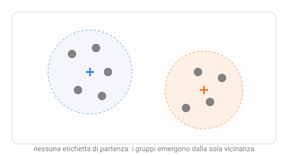

{:class="aside-image"}

### 7.1 Il barattolo di bottoni

Immagina un barattolo pieno di centinaia di bottoni mischiati alla rinfusa, di colori, dimensioni e forme diverse, e il compito di ordinarli in mucchietti, senza che nessuno ti abbia detto in anticipo quante categorie esistono né come si chiamano. Non hai un elenco di etichette da assegnare, come "matura/non matura" nelle lezioni precedenti: hai solo i bottoni stessi, e il tuo unico strumento è notare quali si somigliano fra loro più che con gli altri.

Con ogni probabilità, li smisteresti comunque in gruppi sensati, tutti i bottoni grandi e scuri da una parte, tutti i piccoli e chiari dall'altra, semplicemente osservando quali si assomigliano. Questo è esattamente il compito dell'**apprendimento non supervisionato** introdotto nella Lezione 1: trovare una struttura nascosta dentro dati che non hanno etichette, invece di prevedere un'etichetta già nota. Il compito specifico di raggruppare esempi simili si chiama **clustering** (letteralmente, "raggruppamento in ammassi").

### 7.2 Un caso concreto: i prezzi di un mercatino dell'usato

Facciamo un esempio più vicino al filo conduttore di questo libro. Gestisci un banchetto a un mercatino dell'usato e hai messo in vendita una trentina di oggetti diversi, ciascuno con il proprio prezzo. Non hai etichettato in anticipo nessuna "fascia di prezzo", economico, medio, caro, ma osservando i prezzi ti accorgi che non sono distribuiti in modo uniforme: sembrano addensarsi in due o tre gruppi naturali, con vuoti evidenti fra un gruppo e l'altro. Il clustering è lo strumento che identifica automaticamente questi gruppi, senza che nessuno debba tracciare a mano i confini fra "economico" e "caro".

Questo tipo di analisi ha applicazioni molto concrete: un negozio online può raggruppare i propri clienti in base alle abitudini d'acquisto (chi compra spesso ma poco alla volta, chi compra raramente ma molto) senza conoscere in anticipo quali "tipi" di cliente esistono; un biologo può raggruppare geni che si comportano in modo simile, senza sapere ancora a cosa servano.

### 7.3 L'algoritmo k-means: centri che si spostano verso i loro punti

L'algoritmo di clustering più diffuso si chiama **k-means** ("k medie"), e la sua idea di fondo, come spesso in questo libro, è sorprendentemente semplice una volta vista in azione. Come in k-NN (Lezione 2), rappresentiamo ogni esempio come un punto in uno spazio delle caratteristiche; k-means prova a trovare **k centri** (k, di nuovo, è un numero che scegli tu in anticipo: quanti gruppi vuoi cercare) tali che ogni punto risulti il più vicino possibile al proprio centro assegnato.

Il procedimento è iterativo, cioè si ripete più volte fino a stabilizzarsi:

1. **Inizio**: scegli k punti a caso (spesso presi direttamente fra gli esempi stessi) come centri di partenza.
2. **Assegnazione**: per ogni punto dell'insieme, guarda quale dei k centri è il più vicino, e assegnalo a quel gruppo, esattamente come k-NN cercava il vicino più prossimo, ma qui confrontando ogni punto solo con i pochi centri, non con tutti gli altri punti.
3. **Aggiornamento**: per ogni gruppo appena formato, calcola la sua **media**, la posizione ottenuta facendo la media delle coordinate di tutti i punti assegnati a quel gruppo, e sposta il centro esattamente lì. È da questo passaggio che l'algoritmo prende il nome.
4. **Ripeti**: torna al passo 2 con i centri aggiornati, e continua finché i centri smettono di spostarsi in modo significativo (o, equivalentemente, finché nessun punto cambia più gruppo da un giro all'altro).

<figure style="margin: 2rem 0; text-align: center;">
<svg viewBox="0 0 560 240" xmlns="http://www.w3.org/2000/svg" role="img" aria-labelledby="km-title km-desc" style="width: 100%; max-width: 520px; height: auto; font-family: inherit;">
  <title id="km-title">Due iterazioni di k-means</title>
  <desc id="km-desc">Tre pannelli affiancati: centri di partenza scelti a caso, punti assegnati al centro più vicino, centri ricalcolati come media dei punti assegnati.</desc>

  <text x="90" y="20" fill="#828282" font-size="12" text-anchor="middle">1. centri a caso</text>
  <g fill="#828282"><circle cx="40" cy="80" r="6" /><circle cx="60" cy="60" r="6" /><circle cx="70" cy="100" r="6" /><circle cx="130" cy="150" r="6" /><circle cx="150" cy="170" r="6" /><circle cx="110" cy="190" r="6" /></g>
  <g stroke="#2a7ae2" stroke-width="2"><line x1="53" y1="130" x2="67" y2="130" /><line x1="60" y1="123" x2="60" y2="137" /></g>
  <g stroke="#f66a0a" stroke-width="2"><line x1="93" y1="60" x2="107" y2="60" /><line x1="100" y1="53" x2="100" y2="67" /></g>

  <text x="280" y="20" fill="#828282" font-size="12" text-anchor="middle">2. assegna al più vicino</text>
  <g fill="#2a7ae2"><circle cx="230" cy="80" r="6" /><circle cx="250" cy="60" r="6" /><circle cx="260" cy="100" r="6" /></g>
  <g fill="#f66a0a"><circle cx="320" cy="150" r="6" /><circle cx="340" cy="170" r="6" /><circle cx="300" cy="190" r="6" /></g>
  <g stroke="#2a7ae2" stroke-width="2"><line x1="243" y1="130" x2="257" y2="130" /><line x1="250" y1="123" x2="250" y2="137" /></g>
  <g stroke="#f66a0a" stroke-width="2"><line x1="283" y1="60" x2="297" y2="60" /><line x1="290" y1="53" x2="290" y2="67" /></g>

  <text x="470" y="20" fill="#828282" font-size="12" text-anchor="middle">3. ricalcola i centri</text>
  <g fill="#2a7ae2"><circle cx="420" cy="80" r="6" /><circle cx="440" cy="60" r="6" /><circle cx="450" cy="100" r="6" /></g>
  <g fill="#f66a0a"><circle cx="510" cy="150" r="6" /><circle cx="530" cy="170" r="6" /><circle cx="490" cy="190" r="6" /></g>
  <g stroke="#2a7ae2" stroke-width="2.5"><line x1="430" y1="80" x2="444" y2="80" /><line x1="437" y1="73" x2="437" y2="87" /></g>
  <g stroke="#f66a0a" stroke-width="2.5"><line x1="503" y1="170" x2="517" y2="170" /><line x1="510" y1="163" x2="510" y2="177" /></g>

  <text x="280" y="230" fill="#828282" font-size="11" text-anchor="middle">i passi 2 e 3 si ripetono finché i centri smettono di muoversi</text>
</svg>
<figcaption style="color: #828282; font-size: 0.9rem; margin-top: 0.5rem;">Le croci sono i centri; a ogni giro si spostano verso il centro reale dei punti che hanno appena raccolto.</figcaption>
</figure>

### 7.4 Scegliere k: un'arte, non una scienza esatta

C'è un dettaglio che k-means, a differenza degli algoritmi delle lezioni precedenti, non può risolvere da solo: quanti gruppi cercare, cioè il valore di k, va deciso *prima* di far partire l'algoritmo, e nessun calcolo automatico ti dice con certezza il numero "giusto", perché, semplicemente, potrebbe non esserci un numero oggettivamente corretto. I bottoni del barattolo potrebbero essere ragionevolmente divisi in 2 mucchi grossi (chiari e scuri) oppure in 6 mucchi più fini (per ogni combinazione di colore e dimensione): entrambe le scelte sono "corrette", rispondono solo a domande diverse.

Un trucco pratico diffuso è provare diversi valori di k (2, 3, 4, 5...) e osservare quanto, per ciascun valore, i punti restano compatti attorno al proprio centro: aumentando k questa compattezza migliora sempre (con k pari al numero di punti, ogni punto è il proprio centro, compattezza perfetta ma inutile, un caso limite di overfitting non troppo diverso da quello incontrato nella Lezione 5), ma spesso il miglioramento rallenta bruscamente dopo un certo valore, formando un gomito ben visibile su un grafico: quel gomito è un buon indizio, anche se non una prova matematica, di quale k rifletta davvero una struttura presente nei dati.

### 7.5 Un limite da tenere a mente

Proprio perché non esistono etichette di riferimento, valutare "quanto è bravo" un risultato di clustering è intrinsecamente più sfumato di valutare un modello supervisionato con la matrice di confusione della Lezione 6: non c'è una risposta giusta nota in anticipo con cui confrontarsi. I gruppi trovati da k-means sono utili nella misura in cui aiutano *te*, che li interpreti, a scoprire qualcosa di sensato nei dati, due fasce di prezzo che riflettono davvero due tipi diversi di oggetti in vendita, per esempio, non perché l'algoritmo garantisca in astratto di aver trovato "la verità".

### 7.6 k-means in Python

Il programma applica k-means ai prezzi di un banchetto, una sola caratteristica per volta così da poter leggere facilmente il risultato. La funzione `k_means` segue i passi del paragrafo 7.3, e alla fine viene provato il metodo del gomito del paragrafo 7.4.


import random

def valore_assoluto(numero):
    """ Il valore assoluto è il numero senza segno.
    parametro numero: int o float
    return: int o float, il numero reso positivo
    Esempio: valore_assoluto(-7) restituisce 7
    """
    if numero < 0:
        return -numero
    return numero

def scegli_centri(punti, k):
    """ Inizio: k punti diversi, scelti a caso fra gli esempi, fanno da centri di partenza.
    random.randrange(n) restituisce una posizione a caso fra 0 e n - 1.
    parametro punti: list di numeri, i prezzi
    parametro k: int, quanti gruppi vogliamo
    return: list di k prezzi diversi presi dalla lista.
    Il risultato dipende dal caso: per esempio scegli_centri([2, 3, 18, 20], 2)
    potrebbe restituire [18, 3]
    """
    centri = []
    while len(centri) < k:
        punto = punti[random.randrange(len(punti))]
        if punto not in centri:
            centri.append(punto)
    return centri

def assegna(punti, centri):
    """ Passo di assegnazione: ogni prezzo finisce nel gruppo del centro più vicino.
    parametro punti: list di numeri, i prezzi
    parametro centri: list di numeri, un centro per gruppo
    return: list di list: il gruppo i contiene i prezzi più vicini al centro i
    Esempio: assegna([1, 2, 10, 11], [1, 10]) restituisce [[1, 2], [10, 11]]
    """
    gruppi = []
    for centro in centri:
        gruppi.append([])
    for punto in punti:
        piu_vicino = 0
        for i in range(len(centri)):
            if valore_assoluto(punto - centri[i]) < valore_assoluto(punto - centri[piu_vicino]):
                piu_vicino = i
        gruppi[piu_vicino].append(punto)
    return gruppi

def media(valori):
    """ La media dei valori: la loro somma divisa per quanti sono.
    parametro valori: list di numeri, non vuota
    return: float
    Esempio: media([10, 11]) restituisce 10.5
    """
    somma = 0
    for valore in valori:
        somma = somma + valore
    return somma / len(valori)

def k_means(punti, k):
    """ L'algoritmo k-means: assegna i punti ai centri, sposta ogni centro
    sulla media del suo gruppo, e ripete finché i centri non si muovono più.
    parametro punti: list di numeri, i prezzi
    parametro k: int, quanti gruppi vogliamo
    return: tuple (centri, gruppi): la list dei centri finali
            e la list dei gruppi, come quella restituita da assegna.
    Il risultato dipende dai centri di partenza scelti a caso: per esempio
    k_means([1, 2, 10, 11], 2) potrebbe restituire ([1.5, 10.5], [[1, 2], [10, 11]])
    oppure gli stessi gruppi in ordine inverso.
    """
    centri = scegli_centri(punti, k)
    fermo = False
    while fermo == False:
        gruppi = assegna(punti, centri)
        # Un gruppo rimasto vuoto conserva il centro che aveva.
        nuovi_centri = []
        for i in range(k):
            if len(gruppi[i]) > 0:
                nuovi_centri.append(media(gruppi[i]))
            else:
                nuovi_centri.append(centri[i])
        # Se i centri non si muovono più, l'algoritmo è arrivato a convergenza.
        if nuovi_centri == centri:
            fermo = True
        centri = nuovi_centri
    return centri, gruppi

def lontananza(centri, gruppi):
    """ Somma delle distanze al quadrato di ogni punto dal proprio centro:
    più è bassa, più i gruppi sono compatti.
    parametro centri: list di numeri
    parametro gruppi: list di list, il gruppo i appartiene al centro i
    return: float
    Esempio: lontananza([1.5, 10.5], [[1, 2], [10, 11]]) restituisce 1.0
    (ogni punto dista 0.5 dal suo centro: 4 * 0.5 ** 2 = 1.0)
    """
    somma = 0
    for i in range(len(centri)):
        for punto in gruppi[i]:
            somma = somma + (punto - centri[i]) ** 2
    return somma

def migliore(punti, k, tentativi):
    """ Il risultato di k_means dipende dai centri di partenza: facciamo più
    tentativi e teniamo quello con i gruppi più compatti.
    parametro punti: list di numeri, i prezzi
    parametro k: int, quanti gruppi vogliamo
    parametro tentativi: int, quante volte eseguire k_means
    return: tuple (centri, gruppi), come per k_means, con la lontananza più bassa.
    Per esempio migliore([1, 2, 3, 10, 11], 2, 10) restituisce quasi sicuramente
    i gruppi [1, 2, 3] e [10, 11], con centri 2.0 e 10.5
    """
    centri_migliori, gruppi_migliori = k_means(punti, k)
    for tentativo in range(tentativi - 1):
        centri, gruppi = k_means(punti, k)
        if lontananza(centri, gruppi) < lontananza(centri_migliori, gruppi_migliori):
            centri_migliori = centri
            gruppi_migliori = gruppi
    return centri_migliori, gruppi_migliori

# I prezzi degli oggetti del banchetto: nessuna fascia è indicata in anticipo.
prezzi = [2, 3, 4, 5, 6, 18, 20, 21, 23, 47, 50, 52, 55]

# Fissare il seme rende i numeri casuali sempre uguali a ogni esecuzione.
random.seed(42)

centri, gruppi = migliore(prezzi, 3, 10)
for i in range(len(centri)):
    print("centro", round(centri[i], 2), ":", gruppi[i])

# Il metodo del gomito: osserviamo quanto migliora la compattezza al crescere di k.
print()
for k in range(1, 7):
    centri, gruppi = migliore(prezzi, k, 10)
    print("k =", k, " lontananza", round(lontananza(centri, gruppi), 1))


Eseguendo il programma si ottiene:


centro 51.0 : [47, 50, 52, 55]
centro 20.5 : [18, 20, 21, 23]
centro 4.0 : [2, 3, 4, 5, 6]

k = 1  lontananza 5019.2
k = 2  lontananza 662.0
k = 3  lontananza 57.0
k = 4  lontananza 32.0
k = 5  lontananza 24.5
k = 6  lontananza 16.2


L'algoritmo ha trovato le tre fasce di prezzo senza che nessuno le avesse indicate. Anche il gomito è ben visibile: da k = 1 a k = 3 la lontananza crolla, da 5019,2 a 57,0, mentre dopo k = 3 i miglioramenti diventano piccoli. In questo caso è un indizio chiaro perché i dati sono stati scelti con tre gruppi ben distinti: con dati reali il gomito è spesso molto meno netto.

---

> **Prova tu, Un giro di k-means a mano**
>
> Cinque oggetti del tuo banchetto, con il solo prezzo in euro: 3, 4, 15, 18, 20.
>
> Parti con due centri scelti a caso: **centro A = 3** e **centro B = 18**.
>
> 1. Assegna ciascuno dei cinque prezzi (3, 4, 15, 18, 20) al centro più vicino fra A e B, guardando semplicemente quale dei due dista di meno da ciascun prezzo.
> 2. Calcola la media dei prezzi assegnati al gruppo A, e la media dei prezzi assegnati al gruppo B: questi diventano i nuovi centri.
> 3. Con i centri aggiornati, riassegna ciascuno dei cinque prezzi al centro più vicino. È cambiato qualcosa rispetto al punto 1? Se le assegnazioni sono rimaste identiche, l'algoritmo è arrivato a convergenza, non c'è più bisogno di ripetere il procedimento.

---

## Esercizi

1. Pensa a un insieme di oggetti che potresti raggruppare senza etichette pre-esistenti, per esempio le canzoni della tua libreria musicale, i libri di uno scaffale, gli amici di una chat di gruppo. Descrivi quali caratteristiche useresti per confrontarli.
2. Descrivi, passo per passo con parole tue, cosa succede in un ciclo dell'algoritmo k-means, usando l'esempio di tre centri scelti a caso su un gruppo di punti.
3. Spiega perché scegliere k pari al numero totale di punti disponibili renderebbe la compattezza perfetta, ma il risultato sarebbe comunque inutile.
4. Nella Sezione 7.4 si parla del "metodo del gomito" per scegliere k. Spiega con parole tue cosa significa che il miglioramento della compattezza "rallenta bruscamente" dopo un certo valore di k.
5. A differenza della classificazione della Lezione 6, valutare un risultato di clustering è più soggettivo. Descrivi un caso in cui due persone diverse potrebbero ragionevolmente preferire due valori diversi di k per lo stesso insieme di dati, senza che nessuna delle due abbia necessariamente torto.

---

*Continua con la [Lezione 08, Tante opinioni valgono più di una]({{ site.baseurl }}.html)*
