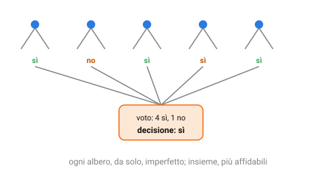

{:class="aside-image"}

### 8.1 Il peso del bue e la saggezza della folla

Nel 1906, allo Smithfield Cattle Show in Inghilterra, si tenne un curioso concorso: quasi 800 persone, contadini, macellai, ma anche perfetti estranei senza nessuna competenza specifica di allevamento, provarono a indovinare il peso di un bue esposto in una fiera, semplicemente guardandolo. Nessuno indovinò il peso esatto. Ma lo scienziato Francis Galton, incuriosito, calcolò la *media* di tutte le stime, comprese quelle palesemente sballate, e scoprì che quella media si scostava dal peso reale del bue (543 kg) di meno di mezzo chilo: 542,5 kg, più precisa di quasi ogni singola stima individuale, compresa quella dei macellai esperti.

Questo fenomeno, oggi chiamato la "saggezza della folla", non è magia: gli errori dei singoli partecipanti tendevano a sbagliare in direzioni diverse e più o meno casuali (chi per eccesso, chi per difetto), e mediandoli insieme questi errori tendevano in buona parte a cancellarsi a vicenda, lasciando emergere il segnale comune sottostante. Questa lezione applica esattamente la stessa idea al machine learning: invece di costruire un solo modello, molto elaborato e potenzialmente incline all'overfitting della Lezione 5, se ne costruiscono **molti**, più semplici, e si combinano le loro previsioni.

### 8.2 Bagging: alberi allenati su fette diverse degli stessi dati

Il modo più diretto di applicare questa idea agli alberi decisionali della Lezione 3 si chiama **bagging** (abbreviazione di *bootstrap aggregating*). L'idea: invece di costruire un solo albero su tutto l'insieme di addestramento, se ne costruiscono molti, anche centinaia, ciascuno addestrato non sull'insieme completo, ma su una fetta scelta a caso, estratta con reinserimento (uno stesso esempio può comparire più volte in una fetta, e non comparire affatto in un'altra).

Ogni singolo albero, vedendo solo una porzione diversa e in parte casuale dei dati, tende a essere leggermente diverso dagli altri, magari sceglie una domanda diversa alla radice, o si spinge a memorizzare particolarità leggermente diverse. Preso da solo, ciascun albero resta soggetto all'overfitting descritto nella Lezione 5. Ma proprio come le stime individuali sul peso del bue, gli errori di questi alberi tendono a essere diversi gli uni dagli altri, non tutti nella stessa direzione: quando si combinano le previsioni di tutti gli alberi, a maggioranza per la classificazione, con una media per la regressione, gli errori individuali tendono in buona parte a cancellarsi, e il risultato complessivo generalizza spesso molto meglio di qualunque singolo albero.

### 8.3 Random forest: aggiungere ancora più varietà

Il bagging da solo funziona, ma ha un limite: se una caratteristica è particolarmente informativa (pensa al "suono cupo" della Lezione 3, quasi perfettamente predittivo da solo), quasi tutti gli alberi tenderanno a sceglierla come domanda alla radice, finendo per assomigliarsi fra loro più di quanto sarebbe utile, e alberi troppo simili fra loro fanno errori troppo simili fra loro, vanificando in parte l'effetto di cancellazione degli errori visto sopra.

La **random forest** ("foresta casuale") aggiunge un secondo livello di casualità proprio per contrastare questo effetto: oltre ad addestrare ogni albero su una fetta casuale dei dati (come nel bagging), a ogni singolo nodo dell'albero, invece di considerare *tutte* le caratteristiche disponibili per scegliere la domanda migliore, se ne considera solo un sottoinsieme scelto a caso. Questo costringe anche gli alberi che vedono gli stessi dati a esplorare strade diverse, aumentando la varietà complessiva della foresta, e con essa, tipicamente, la qualità del voto finale.

<figure style="margin: 2rem 0; text-align: center;">
<svg viewBox="0 0 520 200" xmlns="http://www.w3.org/2000/svg" role="img" aria-labelledby="rf-title rf-desc" style="width: 100%; max-width: 480px; height: auto; font-family: inherit;">
  <title id="rf-title">Dati e caratteristiche mescolati a caso per ogni albero</title>
  <desc id="rf-desc">Un insieme di dati completo viene diviso in fette casuali con reinserimento, e a ogni albero viene mostrato solo un sottoinsieme casuale delle caratteristiche disponibili a ogni nodo.</desc>

  <rect x="20" y="20" width="120" height="60" rx="8" fill="#eef2f7" stroke="#2a7ae2" stroke-width="1.5" />
  <text x="80" y="45" fill="#111" font-size="11" text-anchor="middle">insieme dati</text>
  <text x="80" y="62" fill="#111" font-size="11" text-anchor="middle">completo</text>

  <path d="M 140,50 L 200,50" fill="none" stroke="#828282" stroke-width="1.5" marker-end="url(#af)" />
  <defs><marker id="af" markerWidth="8" markerHeight="8" refX="6" refY="4" orient="auto" markerUnits="userSpaceOnUse"><path d="M0,0 L8,4 L0,8 z" fill="#828282" /></marker></defs>

  <g font-size="10" fill="#111" text-anchor="middle">
    <rect x="210" y="20" width="90" height="34" rx="6" fill="#fdfdfd" stroke="#3aa655" /><text x="255" y="41">fetta 1 + feature casuali</text>
    <rect x="210" y="62" width="90" height="34" rx="6" fill="#fdfdfd" stroke="#3aa655" /><text x="255" y="83">fetta 2 + feature casuali</text>
    <rect x="210" y="104" width="90" height="34" rx="6" fill="#fdfdfd" stroke="#3aa655" /><text x="255" y="125">fetta 3 + feature casuali</text>
  </g>

  <g stroke="#828282" stroke-width="1.5">
    <path d="M 300,37 L 350,37" marker-end="url(#af)" /><path d="M 300,79 L 350,79" marker-end="url(#af)" /><path d="M 300,121 L 350,121" marker-end="url(#af)" />
  </g>
  <g font-size="10" fill="#111" text-anchor="middle">
    <rect x="360" y="20" width="60" height="34" rx="6" fill="#fde8d6" stroke="#f66a0a" /><text x="390" y="41">albero 1</text>
    <rect x="360" y="62" width="60" height="34" rx="6" fill="#fde8d6" stroke="#f66a0a" /><text x="390" y="83">albero 2</text>
    <rect x="360" y="104" width="60" height="34" rx="6" fill="#fde8d6" stroke="#f66a0a" /><text x="390" y="125">albero 3</text>
  </g>

  <text x="260" y="180" fill="#828282" font-size="11" text-anchor="middle">ogni albero vede dati e domande possibili leggermente diversi</text>
</svg>
<figcaption style="color: #828282; font-size: 0.9rem; margin-top: 0.5rem;">La doppia casualità, dati e caratteristiche, è ciò che distingue la random forest dal semplice bagging.</figcaption>
</figure>

### 8.4 Boosting: imparare uno dopo l'altro dagli errori altrui

Bagging e random forest costruiscono i loro modelli **in parallelo**, tutti indipendenti fra loro, e li combinano solo alla fine. Il **boosting** segue invece una strategia opposta e **sequenziale**: costruisce un primo modello semplice (spesso un albero molto piccolo, con solo una o due domande), guarda su quali esempi ha sbagliato, e costruisce un secondo modello che si concentra proprio su quegli esempi difficili, dando loro più peso, un po' come un insegnante che, dopo aver corretto un compito, dedica la lezione successiva soprattutto agli errori più comuni, invece di ripetere daccapo tutto il programma allo stesso ritmo.

Il procedimento continua per molti passaggi: ogni nuovo modello si concentra sugli errori residui lasciati da tutti i modelli precedenti messi insieme, e la previsione finale combina i voti di tutti i modelli costruiti lungo il percorso, spesso dando più peso a quelli che si sono dimostrati più affidabili. Il risultato tende a essere molto accurato, anche se, a differenza del bagging, dove ogni albero è indipendente e quindi facile da addestrare in parallelo su computer diversi, il boosting è intrinsecamente sequenziale: il modello numero 10 non può essere costruito prima di aver visto gli errori dei nove precedenti.

### 8.5 Perché combinare modelli spesso batte un solo modello elaborato

Vale la pena chiudere con la domanda che lega insieme tutta questa lezione: perché mai dovrebbe funzionare meglio combinare cento alberi mediocri piuttosto che costruirne uno solo, il più elaborato e accurato possibile? La risposta, come nel concorso del bue di Galton, sta nel modo in cui si comportano gli errori. Un singolo modello molto complesso rischia l'overfitting descritto nella Lezione 5: i suoi errori su dati nuovi tendono a riflettere le particolarità specifiche, spesso casuali, dell'insieme di addestramento che ha visto. Molti modelli più semplici, ciascuno addestrato su una porzione diversa e in parte casuale dei dati (o concentrato su errori diversi, nel caso del boosting), tendono invece a commettere errori diversi gli uni dagli altri; combinandoli, buona parte di questi errori individuali si cancella a vicenda nella media o nel voto finale, lasciando emergere un segnale più affidabile di quanto qualunque singolo modello, da solo, riuscisse a offrire.

### 8.6 Un nucleo di strumenti, non ancora tutto

Le otto lezioni percorse finora hanno costruito, un pezzo alla volta, il nucleo degli strumenti più usati nel machine learning "classico": imparare da esempi invece che da regole scritte a mano (Lezione 1), classificare guardando i vicini più simili (Lezione 2) o ponendo una sequenza di domande (Lezione 3), prevedere numeri con una retta (Lezione 4), riconoscere e correggere overfitting e underfitting (Lezione 5), misurare onestamente quanto un modello è davvero bravo (Lezione 6), trovare struttura nei dati senza etichette (Lezione 7), e combinare più modelli per ottenere risultati più affidabili di qualunque singolo modello (questa lezione).

Restano ancora alcune idee, altrettanto diffuse nella pratica, che completano questo nucleo prima di chiudere il libro: classificare sommando tanti indizi deboli invece di porli in sequenza (Lezione 9), separare due categorie tracciando il confine più sicuro possibile (Lezione 10), semplificare tanti indizi in pochi senza perdere l'essenziale (Lezione 11), scoprire quali eventi tendono a presentarsi insieme (Lezione 12), e riconoscere ciò che non assomiglia a nulla di già visto (Lezione 13). Con quest'ultima si chiuderà anche il discorso, rimandato fin dalla prefazione, sul limite condiviso da tutti gli algoritmi di questo libro, e su dove porta il passo successivo.

### 8.7 Bagging e random forest in Python

Il programma confronta un solo albero, il bagging e la random forest sulle stesse angurie inventate. Le etichette contengono un po' di rumore, e due caratteristiche su quattro non servono a nulla. L'unica differenza fra bagging e random forest è il parametro `quante_caratteristiche`. Il boosting del paragrafo 8.4 non è incluso, per non allungare troppo il programma.


import random

# In tutto il programma un esempio è una tupla (punto, etichetta): il punto
# è una lista di quattro caratteristiche, per esempio ([7.2, 4.1, 0.5, 9.9], "sì").
# Un albero è fatto di nodi: una foglia è {"foglia": etichetta}, un nodo con una
# domanda ha le chiavi "caratteristica", "soglia", "sinistra" e "destra".

def piu_frequente(etichette):
    """ Conta i voti in un dizionario e restituisce l'etichetta più votata.
    parametro etichette: list di string
    return: string, l'etichetta più frequente (a parità, quella vista per prima)
    Esempio: piu_frequente(["sì", "no", "sì"]) restituisce "sì"
    """
    voti = {}
    for etichetta in etichette:
        if etichetta in voti:
            voti[etichetta] = voti[etichetta] + 1
        else:
            voti[etichetta] = 1
    vincitrice = ""
    for etichetta in voti:
        if vincitrice == "" or voti[etichetta] > voti[vincitrice]:
            vincitrice = etichetta
    return vincitrice

def impurita(etichette):
    """ L'impurità di Gini della Lezione 3: 0 se le etichette sono tutte uguali,
    più alta quanto più sono mescolate.
    parametro etichette: list di string
    return: float fra 0 e 1
    Esempio: impurita(["sì", "sì", "sì"]) restituisce 0
    Esempio: impurita(["sì", "no", "sì", "no"]) restituisce 0.5
    """
    voti = {}
    for etichetta in etichette:
        if etichetta in voti:
            voti[etichetta] = voti[etichetta] + 1
        else:
            voti[etichetta] = 1
    risultato = 1
    for etichetta in voti:
        risultato = risultato - (voti[etichetta] / len(etichette)) ** 2
    return risultato

def scegli_caratteristiche(quante_in_tutto, quante):
    """ Il cuore della random forest: sceglie a caso, senza ripetizioni,
    quali caratteristiche un nodo può usare per porre la domanda.
    parametro quante_in_tutto: int, quante caratteristiche ha ogni punto
    parametro quante: int, quante sceglierne
    return: list di int, le posizioni delle caratteristiche scelte.
    Il risultato dipende dal caso: per esempio scegli_caratteristiche(4, 2)
    potrebbe restituire [3, 0]
    """
    scelte = []
    while len(scelte) < quante:
        c = random.randrange(quante_in_tutto)
        if c not in scelte:
            scelte.append(c)
    return scelte

def costruisci_albero(esempi, quante_caratteristiche, profondita):
    """ Costruisce un albero con domande del tipo "la caratteristica c è minore
    della soglia?", scegliendo a ogni nodo la domanda che lascia i gruppi più puri.
    parametro esempi: list di tuple (punto, etichetta)
    parametro quante_caratteristiche: int, fra quante caratteristiche scelte a caso
                                      ogni nodo può cercare la domanda
    parametro profondita: int, quante domande al massimo una dopo l'altra
    return: dict, la radice dell'albero
    Esempio: costruisci_albero([([1], "no"), ([9], "sì")], 1, 5)
             restituisce {"caratteristica": 0, "soglia": 9,
                          "sinistra": {"foglia": "no"}, "destra": {"foglia": "sì"}}
    (la domanda è "la caratteristica 0 è minore di 9?")
    """
    etichette = []
    for esempio in esempi:
        etichette.append(esempio[1])
    if impurita(etichette) == 0 or profondita == 0:
        return {"foglia": piu_frequente(etichette)}

    migliore = None
    impurita_minima = impurita(etichette)
    for c in scegli_caratteristiche(len(esempi[0][0]), quante_caratteristiche):
        # Ogni valore della caratteristica può fare da soglia.
        soglie = []
        for esempio in esempi:
            if esempio[0][c] not in soglie:
                soglie.append(esempio[0][c])
        for soglia in soglie:
            sinistra = []
            destra = []
            for esempio in esempi:
                if esempio[0][c] < soglia:
                    sinistra.append(esempio[1])
                else:
                    destra.append(esempio[1])
            if len(sinistra) > 0 and len(destra) > 0:
                valore = (len(sinistra) * impurita(sinistra)
                          + len(destra) * impurita(destra)) / len(esempi)
                if valore < impurita_minima:
                    impurita_minima = valore
                    migliore = (c, soglia)

    if migliore == None:
        return {"foglia": piu_frequente(etichette)}

    c, soglia = migliore
    esempi_sinistra = []
    esempi_destra = []
    for esempio in esempi:
        if esempio[0][c] < soglia:
            esempi_sinistra.append(esempio)
        else:
            esempi_destra.append(esempio)
    return {"caratteristica": c,
            "soglia": soglia,
            "sinistra": costruisci_albero(esempi_sinistra, quante_caratteristiche, profondita - 1),
            "destra": costruisci_albero(esempi_destra, quante_caratteristiche, profondita - 1)}

def prevedi_albero(nodo, punto):
    """ Scende dalla radice finché non arriva a una foglia.
    parametro nodo: dict, la radice dell'albero
    parametro punto: list di caratteristiche
    return: string, l'etichetta della foglia raggiunta
    Esempio: prevedi_albero({"caratteristica": 0, "soglia": 9,
                             "sinistra": {"foglia": "no"}, "destra": {"foglia": "sì"}},
                            [4]) restituisce "no"
    """
    while "foglia" not in nodo:
        if punto[nodo["caratteristica"]] < nodo["soglia"]:
            nodo = nodo["sinistra"]
        else:
            nodo = nodo["destra"]
    return nodo["foglia"]

def costruisci_foresta(esempi, quanti_alberi, quante_caratteristiche):
    """ Costruisce molti alberi, ognuno su una fetta casuale degli esempi
    estratta con reinserimento: lo stesso esempio può uscire più volte.
    parametro esempi: list di tuple (punto, etichetta)
    parametro quanti_alberi: int
    parametro quante_caratteristiche: int, come per costruisci_albero:
                                      con tutte si ottiene il bagging,
                                      con meno la random forest
    return: list di alberi (dict), uno per ogni albero costruito.
    Il risultato dipende dal caso: per esempio
    costruisci_foresta([([1], "no"), ([9], "sì")], 2, 1) potrebbe restituire
    [{"foglia": "no"}, {"caratteristica": 0, "soglia": 9, ...}],
    se nella prima fetta è uscito due volte lo stesso esempio.
    """
    foresta = []
    for albero in range(quanti_alberi):
        fetta = []
        for i in range(len(esempi)):
            fetta.append(esempi[random.randrange(len(esempi))])
        foresta.append(costruisci_albero(fetta, quante_caratteristiche, 20))
    return foresta

def prevedi_foresta(foresta, punto):
    """ Il voto a maggioranza fra tutti gli alberi.
    parametro foresta: list di alberi (dict)
    parametro punto: list di caratteristiche
    return: string, l'etichetta che ha ricevuto più voti
    Esempio: prevedi_foresta([{"foglia": "sì"}, {"foglia": "no"}, {"foglia": "sì"}],
                             [5, 5, 5, 5]) restituisce "sì"
    """
    voti = []
    for albero in foresta:
        voti.append(prevedi_albero(albero, punto))
    return piu_frequente(voti)

def percentuale_giusti(previsioni, esempi):
    """ Confronta le previsioni con le etichette vere.
    parametro previsioni: list di string, una per esempio
    parametro esempi: list di tuple (punto, etichetta), nello stesso ordine
    return: float, la percentuale di previsioni giuste, con una cifra decimale
    Esempio: percentuale_giusti(["sì", "no", "no"],
                                [([1], "sì"), ([2], "no"), ([3], "sì")]) restituisce 66.7
    """
    giusti = 0
    for i in range(len(esempi)):
        if previsioni[i] == esempi[i][1]:
            giusti = giusti + 1
    return round(100 * giusti / len(esempi), 1)

def crea_angurie(quante):
    """ Inventa delle angurie con quattro caratteristiche fra 0 e 10: solo le
    prime due influenzano davvero l'etichetta, e il 15% delle etichette viene
    invertito per simulare il rumore.
    parametro quante: int, quante angurie creare
    return: list di tuple (punto, etichetta).
    Il risultato dipende dal caso: per esempio crea_angurie(1) potrebbe
    restituire [([6.4, 0.3, 2.8, 2.2], "no")]
    """
    angurie = []
    for i in range(quante):
        punto = []
        for c in range(4):
            punto.append(random.random() * 10)
        if punto[0] + punto[1] > 10:
            etichetta = "sì"
        else:
            etichetta = "no"
        if random.random() < 0.15:
            if etichetta == "sì":
                etichetta = "no"
            else:
                etichetta = "sì"
        angurie.append((punto, etichetta))
    return angurie

# Fissare il seme rende i numeri casuali sempre uguali a ogni esecuzione.
random.seed(42)
addestramento = crea_angurie(200)
test = crea_angurie(500)

# Un solo albero, su tutti i dati e senza freni: tende all'overfitting.
albero = costruisci_albero(addestramento, 4, 20)
# Bagging: fette casuali, ma ogni nodo vede tutte e quattro le caratteristiche.
bagging = costruisci_foresta(addestramento, 25, 4)
# Random forest: fette casuali e, a ogni nodo, solo due caratteristiche a caso.
foresta = costruisci_foresta(addestramento, 25, 2)

previsioni_albero = []
previsioni_bagging = []
previsioni_foresta = []
for esempio in test:
    previsioni_albero.append(prevedi_albero(albero, esempio[0]))
    previsioni_bagging.append(prevedi_foresta(bagging, esempio[0]))
    previsioni_foresta.append(prevedi_foresta(foresta, esempio[0]))

print("Un solo albero: " + str(percentuale_giusti(previsioni_albero, test)) + "%")
print("Bagging:        " + str(percentuale_giusti(previsioni_bagging, test)) + "%")
print("Random forest:  " + str(percentuale_giusti(previsioni_foresta, test)) + "%")


Eseguendo il programma si ottiene:


Un solo albero: 65.4%
Bagging:        78.6%
Random forest:  78.0%


Combinare gli alberi migliora il risultato: qui di oltre dieci punti percentuali rispetto al singolo albero. Questa esecuzione è particolarmente favorevole: cambiando il seme casuale il vantaggio resta, ma di solito è più piccolo, fra i tre e i dodici punti nelle prove fatte con altri semi. Fra bagging e random forest, invece, la differenza qui è minima, e cambiando il seme casuale può anche invertirsi: in questi dati non c'è una sola caratteristica dominante che renda gli alberi troppo simili, il caso descritto nel paragrafo 8.3 in cui la random forest dà il vantaggio maggiore.

---

> **Prova tu, Il voto di cinque alberi**
>
> Cinque piccoli alberi decisionali, ciascuno addestrato su una fetta diversa degli stessi dati, sono stati messi alla prova su tre angurie nuove. Ecco le loro previsioni individuali, e la verità (scoperta poi aprendo le angurie):
>
> | Anguria | Albero 1 | Albero 2 | Albero 3 | Albero 4 | Albero 5 | Verità |
> |---|---|---|---|---|---|---|
> | X | sì | sì | no | sì | sì | sì |
> | Y | no | sì | no | no | sì | no |
> | Z | sì | no | sì | sì | no | sì |
>
> 1. Per ciascuna anguria, calcola il voto di maggioranza fra i cinque alberi, e verifica se corrisponde alla verità.
> 2. Guarda ora l'Albero 3 da solo: su quante delle tre angurie ha risposto correttamente? E l'Albero 2, da solo?
> 3. Confronta l'accuratezza del voto di maggioranza (calcolata al punto 1) con l'accuratezza del singolo albero meno accurato che hai trovato al punto 2. Cosa dimostra questo confronto sul valore di combinare più modelli, anche quando alcuni di essi, presi singolarmente, sbagliano spesso?

---

## Esercizi

1. Racconta con parole tue l'esperimento del bue di Galton, e spiega perché la media di tante stime imprecise può risultare più accurata di quasi ogni singola stima.
2. Spiega la differenza principale fra bagging e random forest: cosa aggiunge la random forest rispetto al semplice bagging, e perché questo aiuta quando esiste una caratteristica molto informativa che quasi tutti gli alberi sceglierebbero alla radice.
3. Spiega perché il boosting è intrinsecamente sequenziale, mentre bagging e random forest possono essere addestrati in parallelo su computer diversi.
4. Descrivi, con parole tue, in che modo il boosting somiglia al lavoro di un insegnante che, dopo aver corretto un compito, concentra la lezione successiva sugli errori più comuni.
5. Perché, in generale, combinare molti modelli semplici tende a generalizzare meglio di un singolo modello molto complesso? Collega la tua risposta al concetto di overfitting visto nella Lezione 5.

---

*Continua con la [Lezione 09, La somma degli indizi]({{ site.baseurl }}.html)*
