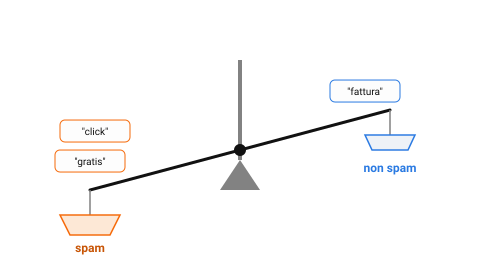

{:class="aside-image"}

### 9.1 Il medico che soppesa sintomi deboli

Immagina un medico alle prese con una diagnosi difficile. Nessun sintomo singolo, da solo, è una prova definitiva: la febbre capita per mille motivi, la stanchezza pure, un certo valore del sangue leggermente alto ancora di più. Eppure il medico non si blocca di fronte a questa incertezza: soppesa ogni sintomo, quanto è comune nei pazienti che hanno davvero quella malattia, quanto lo è in quelli che non ce l'hanno, e li **somma** mentalmente. Preso singolarmente ogni indizio è debole, quasi inutile; messi insieme, spesso bastano a orientare la diagnosi con buona sicurezza.

Le lezioni precedenti hanno affrontato la classificazione guardando la distanza fra punti (Lezione 2) o ponendo domande in sequenza (Lezione 3). Questa lezione introduce una terza famiglia di idee, altrettanto diffusa: classificare **sommando indizi**, ciascuno debole preso da solo, secondo quanto ogni indizio è tipico dell'una o dell'altra categoria. L'algoritmo che applica questa idea nella sua forma più diffusa si chiama **Naive Bayes**.

### 9.2 Un filtro antispam fatto di parole

Il caso d'uso più classico di questa famiglia di algoritmi è proprio il filtro antispam accennato nella Lezione 1. Immagina di avere già analizzato migliaia di email passate, alcune segnalate come spam, altre no, e di aver contato, per ogni parola che ti interessa, quanto spesso compare nell'uno o nell'altro gruppo. Per esempio:

- la parola "gratis" compare nel 70% delle email di spam, ma solo nel 5% delle email normali;
- la parola "click" compare nel 60% delle email di spam, ma solo nell'8% delle email normali;
- la parola "fattura" compare nel 10% delle email di spam, ma nel 40% delle email normali.

Ognuna di queste percentuali è un **indizio**: se un'email nuova contiene "gratis", quella singola parola sposta la bilancia verso lo spam, perché è molto più comune lì che nelle email normali. Se contiene "fattura", la sposta verso il non spam, perché succede il contrario. Nessuna parola, da sola, è una prova certa, un'email normale può benissimo contenere la parola "gratis" una volta ogni tanto, ma la direzione in cui pende ciascun indizio è comunque un'informazione preziosa.

### 9.3 L'ingrediente "naive": trattare gli indizi come indipendenti

Il nome Naive Bayes contiene una parola che è già una confessione onesta: **naive**, "ingenuo". L'algoritmo, per poter sommare gli indizi in modo semplice, fa un'assunzione che nella realtà è quasi sempre falsa: tratta ogni parola come se comparisse nell'email **indipendentemente** dalle altre, come se sapere che c'è "gratis" non cambiasse in nulla la probabilità di trovarci anche "click".

Nella realtà, ovviamente, le parole non sono indipendenti: un'email che contiene "gratis" ha più probabilità di contenere anche "click" o "vincita", proprio perché lo spam tende a usare un vocabolario ricorrente, le parole si trascinano a vicenda. L'assunzione di indipendenza è quindi, tecnicamente, sbagliata. Eppure, ed è qui la sorpresa che dà fama a questo algoritmo, **funziona comunque sorprendentemente bene** nella pratica, anche quando l'assunzione alla base è chiaramente semplificata rispetto alla realtà: quello che conta, per classificare correttamente, è spesso solo la *direzione* verso cui pendono gli indizi combinati, più che il calcolo esatto di quanto siano davvero collegati fra loro.

### 9.4 Come si combinano gli indizi

Il modo più semplice per farsi un'idea di come Naive Bayes combina gli indizi, senza scrivere alcuna formula, è pensare a un punteggio: ogni parola presente in un'email nuova aggiunge punti a favore dello spam o del non spam, in proporzione a quanto quella parola è tipica dell'una o dell'altra categoria, e alla fine vince la categoria con il punteggio complessivo più alto.

<figure style="margin: 2rem 0; text-align: center;">
<svg viewBox="0 0 520 220" xmlns="http://www.w3.org/2000/svg" role="img" aria-labelledby="nb-title nb-desc" style="width: 100%; max-width: 480px; height: auto; font-family: inherit;">
  <title id="nb-title">Tre indizi che si sommano in un punteggio finale</title>
  <desc id="nb-desc">Le parole gratis, click e fattura, ciascuna con una freccia verso spam o verso non spam, che confluiscono in una somma finale.</desc>

  <g font-size="11" fill="#111" text-anchor="middle">
    <rect x="20" y="20" width="100" height="30" rx="6" fill="#fdfdfd" stroke="#e3e3e3" /><text x="70" y="40">"gratis" presente</text>
    <rect x="20" y="70" width="100" height="30" rx="6" fill="#fdfdfd" stroke="#e3e3e3" /><text x="70" y="90">"click" presente</text>
    <rect x="20" y="120" width="100" height="30" rx="6" fill="#fdfdfd" stroke="#e3e3e3" /><text x="70" y="140">"fattura" assente</text>
  </g>

  <g stroke="#828282" stroke-width="1.5"><path d="M 120,35 L 220,35" marker-end="url(#nbaf)" /><path d="M 120,85 L 220,85" marker-end="url(#nbaf)" /><path d="M 120,135 L 220,135" marker-end="url(#nbaf)" /></g>
  <defs><marker id="nbaf" markerWidth="8" markerHeight="8" refX="6" refY="4" orient="auto" markerUnits="userSpaceOnUse"><path d="M0,0 L8,4 L0,8 z" fill="#828282" /></marker></defs>

  <g font-size="11" text-anchor="middle" font-weight="bold">
    <text x="270" y="40" fill="#c85506">forte verso spam</text>
    <text x="270" y="90" fill="#c85506">verso spam</text>
    <text x="270" y="140" fill="#828282">nessun contributo</text>
  </g>

  <path d="M 380,35 L 440,90" stroke="#828282" stroke-width="1.5" /><path d="M 380,85 L 440,90" stroke="#828282" stroke-width="1.5" /><path d="M 380,135 L 440,90" stroke="#828282" stroke-width="1.5" />

  <rect x="440" y="70" width="70" height="40" rx="8" fill="#fde8d6" stroke="#f66a0a" stroke-width="1.5" />
  <text x="475" y="94" fill="#111" font-size="11" text-anchor="middle" font-weight="bold">spam</text>
</svg>
<figcaption style="color: #828282; font-size: 0.9rem; margin-top: 0.5rem;">Ogni parola presente (o assente) contribuisce con la propria direzione al punteggio finale.</figcaption>
</figure>

Più un indizio è squilibrato fra le due categorie (una parola che compare nel 70% dello spam ma solo nel 5% delle email normali), più il suo contributo al punteggio finale pesa; una parola che compare più o meno allo stesso modo in entrambe le categorie, invece, non sposta quasi nulla, perché non aiuta a distinguerle. È esattamente lo stesso principio della domanda "buona" per un albero decisionale nella Lezione 3, un indizio è utile quanto più separa nettamente le categorie, solo che qui gli indizi non vengono posti in sequenza, uno alla volta, ma sommati tutti insieme.

### 9.5 Quando funziona bene, e quando no

Naive Bayes resta oggi uno degli algoritmi più usati per problemi con moltissimi indizi piccoli e in buona parte indipendenti fra loro, come le singole parole di un testo: filtri antispam, certo, ma anche classificazione di recensioni (positiva o negativa), smistamento automatico di articoli per argomento. È inoltre molto veloce da addestrare, anche su milioni di esempi, perché contare quanto spesso ogni parola compare in ogni categoria è un'operazione semplice, molto più leggera di costruire un albero decisionale o cercare i vicini più prossimi su grandi quantità di dati.

Il suo punto debole emerge quando l'assunzione di indipendenza viene tradita in modo troppo vistoso: se due indizi sono fortemente collegati fra loro e portano, di fatto, la stessa informazione ripetuta due volte, Naive Bayes rischia di "contarla due volte", dando più peso di quanto meriterebbe a quell'informazione duplicata. È un limite da conoscere, non un motivo per scartare l'algoritmo: nella pratica, specialmente con indizi numerosi come le parole di un testo, il vantaggio della semplicità e della velocità supera quasi sempre lo svantaggio dell'assunzione semplificata.

### 9.6 Naive Bayes in Python

Il programma impara da undici email di esempio, contando in quante compare ogni parola, e assegna poi un punteggio a ogni categoria come descritto nel paragrafo 9.4. Ogni indizio moltiplica il punteggio di una categoria per un numero fra 0 e 1, tanto più piccolo quanto meno l'indizio è tipico di quella categoria: alla fine i punteggi sono numeri piccolissimi, perciò il programma stampa quante volte il punteggio vincente supera l'altro.


def parole_diverse(testo):
    """ Spezza il testo nelle sue parole, separate da spazi, tenendo
    ogni parola una sola volta anche se compare più volte.
    parametro testo: string
    return: list di string, le parole nell'ordine in cui compaiono
    Esempio: parole_diverse("click qui click") restituisce ["click", "qui"]
    """
    parole = []
    parola = ""
    for carattere in testo + " ":
        if carattere == " ":
            if parola != "" and parola not in parole:
                parole.append(parola)
            parola = ""
        else:
            parola = parola + carattere
    return parole

def addestra(email):
    """ L'addestramento è solo un conteggio: per ogni categoria, quante email
    ci sono e in quante di queste compare ogni parola.
    parametro email: list di tuple (testo, categoria), per esempio
                     [("offerta gratis", "spam"), ("ti invio la fattura", "normale")]
    return: tuple (totali, conteggi, vocabolario), il modello:
            totali è un dict categoria -> numero di email,
            conteggi è un dict categoria -> dict parola -> in quante email compare,
            vocabolario è la list di tutte le parole viste.
    Esempio: addestra([("gratis click", "spam"), ("fattura", "normale")])
             restituisce ({"spam": 1, "normale": 1},
                          {"spam": {"gratis": 1, "click": 1}, "normale": {"fattura": 1}},
                          ["gratis", "click", "fattura"])
    """
    totali = {}
    conteggi = {}
    vocabolario = []
    for esempio in email:
        testo, categoria = esempio
        if categoria not in totali:
            totali[categoria] = 0
            conteggi[categoria] = {}
        totali[categoria] = totali[categoria] + 1
        for parola in parole_diverse(testo):
            if parola in conteggi[categoria]:
                conteggi[categoria][parola] = conteggi[categoria][parola] + 1
            else:
                conteggi[categoria][parola] = 1
            if parola not in vocabolario:
                vocabolario.append(parola)
    return totali, conteggi, vocabolario

def punteggi(modello, testo):
    """ Assegna un punteggio a ogni categoria: si parte da quanto è comune la
    categoria e lo si moltiplica per un fattore per ogni parola del vocabolario.
    parametro modello: tuple (totali, conteggi, vocabolario) restituita da addestra
    parametro testo: string, l'email da classificare
    return: dict categoria -> punteggio (float): vince il più alto
    Esempio: punteggi(addestra([("gratis click", "spam"), ("fattura", "normale")]),
                      "gratis") restituisce circa {"spam": 0.074, "normale": 0.037}
    (per lo spam: 1/2 delle email, poi "gratis" presente 2/3, "click" assente 1/3,
    "fattura" assente 2/3, e 1/2 * 2/3 * 1/3 * 2/3 = 0.074)
    """
    totali, conteggi, vocabolario = modello
    parole = parole_diverse(testo)
    numero_email = 0
    for categoria in totali:
        numero_email = numero_email + totali[categoria]

    risultato = {}
    for categoria in totali:
        # Si parte da quanto è comune la categoria in generale.
        punteggio = totali[categoria] / numero_email
        for parola in vocabolario:
            presenze = 0
            if parola in conteggi[categoria]:
                presenze = conteggi[categoria][parola]
            # Quanto spesso la parola compare in questa categoria. Il +1 e il +2
            # evitano che una parola mai vista in una categoria la escluda del tutto.
            p = (presenze + 1) / (totali[categoria] + 2)
            # Ecco l'ingenuità: ogni indizio viene combinato con gli altri come se
            # fosse indipendente. Un indizio tipico della categoria moltiplica il
            # punteggio per un numero vicino a 1, uno raro lo rimpicciolisce molto.
            # Conta anche l'assenza di una parola, non solo la presenza.
            if parola in parole:
                punteggio = punteggio * p
            else:
                punteggio = punteggio * (1 - p)
        risultato[categoria] = punteggio
    return risultato

email = [
    ("vinci subito un premio gratis", "spam"),
    ("offerta gratis click qui", "spam"),
    ("click qui per il tuo premio", "spam"),
    ("sconto incredibile offerta click", "spam"),
    ("gratis solo oggi vinci sconto", "spam"),
    ("ti invio la fattura di marzo", "normale"),
    ("riunione di lavoro domani mattina", "normale"),
    ("domani ti mando la fattura", "normale"),
    ("il verbale della riunione di oggi", "normale"),
    ("ci vediamo domani per il pranzo", "normale"),
    ("grazie per il pranzo di oggi", "normale"),
]

modello = addestra(email)

for testo in ["vinci subito un premio",
              "verbale della riunione di domani",
              "un premio per la riunione"]:
    risultato = punteggi(modello, testo)
    spam = risultato["spam"]
    normale = risultato["normale"]
    print(testo)
    # I punteggi sono numeri piccolissimi: confrontiamo quante volte uno supera l'altro.
    if spam > normale:
        print("  spam, " + str(round(spam / normale, 1)) + " volte più probabile di normale")
    else:
        print("  normale, " + str(round(normale / spam, 1)) + " volte più probabile di spam")


Eseguendo il programma si ottiene:


vinci subito un premio
  spam, 250.8 volte più probabile di normale
verbale della riunione di domani
  normale, 744.4 volte più probabile di spam
un premio per la riunione
  normale, 1.1 volte più probabile di spam


Nei primi due casi gli indizi puntano tutti nella stessa direzione, e il distacco è netto. Nel terzo, "premio" spinge verso lo spam e "riunione" verso le email normali: i due indizi quasi si annullano e i due punteggi risultano praticamente uguali. Con così pochi esempi i numeri sono solo dimostrativi, un filtro vero ne conta milioni.

---

> **Prova tu, Classifica tre email nuove**
>
> Dall'analisi di migliaia di email passate, conosci queste percentuali:
>
> | Parola | % nelle email di spam | % nelle email normali |
> |---|---|---|
> | "gratis" | 70% | 5% |
> | "click" | 60% | 8% |
> | "fattura" | 10% | 40% |
>
> Per ogni parola presente in un'email nuova, considerala un indizio che pende verso la categoria dove la percentuale è più alta; più il divario fra le due percentuali è ampio, più l'indizio è forte.
>
> 1. Un'email nuova contiene le parole "gratis" e "click", ma non "fattura". Per ciascuna parola presente, verso quale categoria pende l'indizio? Come classificheresti complessivamente questa email?
> 2. Una seconda email contiene solo la parola "fattura", nessuna delle altre due. Come la classificheresti?
> 3. Una terza email contiene sia "gratis" sia "fattura" (ma non "click"), due indizi che puntano in direzioni opposte. Confrontando il divario fra le percentuali di ciascuna delle due parole, quale dei due indizi ti sembra più forte, e quindi più decisivo per la classificazione finale?

---

## Esercizi

1. Pensa a un contesto diverso dallo spam in cui potresti classificare qualcosa "sommando indizi deboli", per esempio capire se la recensione di un ristorante è positiva o negativa guardando le singole parole usate. Elenca tre parole o indizi che useresti, e verso quale categoria pensi che ciascuno penderebbe.
2. Spiega, con parole tue, cosa significa l'assunzione "naive" (ingenua) di indipendenza fra le parole, e fai un esempio concreto di due parole che, nella realtà, non sono affatto indipendenti fra loro in un'email di spam.
3. Perché, nonostante l'assunzione di indipendenza sia quasi sempre falsa nella realtà, Naive Bayes funziona comunque bene in pratica per molti problemi di classificazione di testo?
4. Descrivi una situazione in cui la violazione dell'assunzione di indipendenza potrebbe far sì che Naive Bayes "conti due volte" la stessa informazione, e spiega quale effetto avrebbe sul punteggio finale.
5. Confronta Naive Bayes con l'albero decisionale della Lezione 3: in che modo il modo di "usare gli indizi" è diverso fra i due algoritmi, in sequenza contro sommati insieme?

---

*Continua con la [Lezione 10, La strada più larga]({{ site.baseurl }}.html)*
