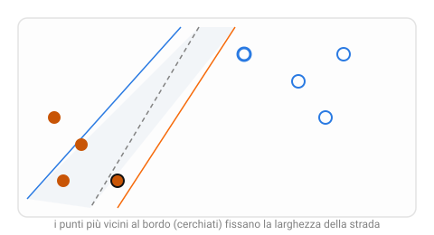

{:class="aside-image"}

### 10.1 Non basta separare, bisogna separare bene

Torna per un momento allo spazio delle caratteristiche introdotto nella Lezione 2, la mappa immaginaria in cui ogni esempio diventa un punto. Se due categorie, angurie mature e non mature per esempio, formano due nuvole di punti ben distinte su questa mappa, esistono di solito **moltissime** linee diverse capaci di separarle correttamente: una leggermente più a sinistra, una più inclinata, una che passa quasi rasente a un punto di un gruppo. Tutte classificano correttamente gli esempi noti. Ma non sono tutte ugualmente buone.

Immagina di dover tracciare una strada fra due quartieri di una città, quartiere A a sinistra, quartiere B a destra, senza che la strada tocchi nessuna casa. Potresti tracciarla proprio rasente alle case del quartiere A, lasciando tantissimo spazio dalla parte di B, oppure esattamente a metà strada fra le case più vicine dei due quartieri. La seconda scelta è più prudente: se una nuova casa venisse costruita, con una posizione leggermente incerta vicino al confine, la strada tracciata a metà ha più probabilità di restare comunque dalla parte giusta. Questa è l'intuizione dietro l'algoritmo di questa lezione, la **Support Vector Machine** (SVM, "macchina a vettori di supporto").

### 10.2 Il margine: quanto spazio resta libero attorno al confine

SVM non si accontenta di trovare una linea qualsiasi che separi le due categorie: cerca **la strada più larga possibile** fra loro, la linea di confine che massimizza la distanza dai punti più vicini di entrambe le categorie. Questa distanza si chiama **margine**, ed è precisamente la larghezza della strada dell'analogia. Fra tutte le linee che separano correttamente gli esempi noti, ne esiste sempre una, e in generale una sola, che rende il margine il più ampio possibile.

Perché un margine ampio è preferibile? Perché rappresenta una scelta più "prudente": un confine tracciato con pochissimo spazio da un lato rischia di classificare male anche piccolissime variazioni rispetto agli esempi visti in addestramento, esattamente come una strada troppo rasente alle case del quartiere A lascerebbe pochissimo margine di errore a chiunque costruisse una casa nuova vicino al confine. Un margine ampio, al contrario, tende a generalizzare meglio su esempi nuovi mai visti prima, proprio il problema di generalizzazione affrontato nella Lezione 5.

### 10.3 I vettori di supporto: solo i punti sul bordo contano

C'è un dettaglio sorprendente in come SVM arriva a tracciare questa strada: la sua posizione e larghezza dipendono **soltanto** dai punti più vicini al confine, quelli che toccano letteralmente i due bordi della strada. Nell'analogia della città, sono le case più vicine al confine fra i due quartieri, quelle proprio a ridosso della strada; tutte le altre case, più lontane dal confine, potrebbero essere spostate ovunque, o persino rimosse, senza cambiare di una virgola la strada tracciata.

Questi punti speciali, quelli che "sostengono" la posizione della strada, si chiamano **vettori di supporto** (da qui il nome dell'algoritmo). È una differenza profonda rispetto alla regressione lineare della Lezione 4, dove ogni singolo punto contribuisce sempre a determinare la retta migliore: in SVM, la maggioranza degli esempi di addestramento, quelli lontani dal confine, sono del tutto ininfluenti sul risultato finale.

### 10.4 Quando i confini non sono dritti

Non tutte le categorie sono separabili con una linea dritta. Immagina punti di un colore raccolti in un cerchio al centro della mappa, e punti dell'altro colore che li circondano tutt'intorno, come un bersaglio: nessuna linea dritta può separare il centro dal contorno. La soluzione usata da SVM in questi casi, chiamata **kernel trick** ("trucco del nucleo"), è tanto elegante quanto la sua descrizione senza formule può renderla: consiste nel proiettare i punti in uno spazio con più dimensioni, dove diventano separabili con un confine dritto, per poi "riportare" quel confine dritto nello spazio originale, dove appare curvo.

Un modo di visualizzarlo: immagina di sollevare fisicamente i punti del cerchio centrale, come se il foglio si gonfiasse al centro creando una collina, mentre i punti del contorno restano bassi sul piano. Vista di lato, questa collina rende ora possibile tagliare nettamente, con un piano dritto, i punti in alto (il centro) da quelli in basso (il contorno). Riportando quel taglio dritto sul foglio piatto originale, il confine appare come un cerchio curvo, esattamente il confine che serviva fin dall'inizio, ma impossibile da tracciare dritto nello spazio di partenza.

### 10.5 Quando usarla

SVM è particolarmente efficace quando gli esempi di addestramento sono relativamente pochi ma le caratteristiche sono molte, testi classificati per argomento, dati genomici, immagini mediche con migliaia di misurazioni per paziente, casi in cui altri algoritmi rischiano più facilmente l'overfitting descritto nella Lezione 5. Il suo punto debole è la scalabilità: su insiemi di addestramento molto grandi, milioni di esempi, il calcolo del margine ottimale diventa lento, e altri algoritmi, come la random forest della Lezione 8, tendono a essere preferiti per pura praticità computazionale.

### 10.6 La strada più larga in Python

I programmi reali usano un metodo matematico che qui non approfondiamo, ma con due sole caratteristiche possiamo arrivare allo stesso risultato in un modo molto più intuitivo: provare tante direzioni e tenere quella che lascia la strada più larga. Il programma funziona solo con gruppi separabili da una linea dritta, e non comprende il kernel trick del paragrafo 10.4.


# In tutto il programma un punto è una tupla (x, y) e una direzione è una
# tupla (dx, dy): la direzione (2, 1) significa 2 passi verso destra e 1 verso l'alto.

def proietta(punto, direzione):
    """ La posizione del punto lungo una direzione, come la sua ombra su una riga.
    Dividere per la lunghezza della direzione fa sì che conti solo dove punta:
    (2, 1) e (4, 2) danno lo stesso risultato.
    parametro punto: tuple (x, y)
    parametro direzione: tuple (dx, dy), diversa da (0, 0)
    return: float
    Esempio: proietta((3, 4), (1, 0)) restituisce 3.0
    (lungo la direzione orizzontale conta solo la x)
    Esempio: proietta((3, 4), (0, 2)) restituisce 4.0
    """
    dx, dy = direzione
    lunghezza = (dx ** 2 + dy ** 2) ** 0.5
    return (punto[0] * dx + punto[1] * dy) / lunghezza

def larghezza(gruppo_a, gruppo_b, direzione):
    """ Vista lungo questa direzione, la strada va dal punto più avanzato di A
    al punto più arretrato di B.
    parametro gruppo_a: list di punti, il gruppo che deve stare "prima"
    parametro gruppo_b: list di punti, il gruppo che deve stare "dopo"
    parametro direzione: tuple (dx, dy)
    return: tuple (margine, bordo_a, bordo_b) di float: margine è la larghezza
            della strada, negativa se i due gruppi si sovrappongono
    Esempio: larghezza([(1, 1), (2, 3)], [(5, 1)], (1, 0)) restituisce (3.0, 2.0, 5.0)
    """
    bordo_a = proietta(gruppo_a[0], direzione)
    for punto in gruppo_a:
        if proietta(punto, direzione) > bordo_a:
            bordo_a = proietta(punto, direzione)
    bordo_b = proietta(gruppo_b[0], direzione)
    for punto in gruppo_b:
        if proietta(punto, direzione) < bordo_b:
            bordo_b = proietta(punto, direzione)
    return bordo_b - bordo_a, bordo_a, bordo_b

def strada_piu_larga(gruppo_a, gruppo_b):
    """ Prova tutte le direzioni (dx, dy) con dx e dy fra -20 e 20
    e tiene quella che lascia la strada più larga.
    parametro gruppo_a: list di punti
    parametro gruppo_b: list di punti
    return: tuple (dx, dy), la direzione migliore
    Esempio: strada_piu_larga([(1, 1)], [(5, 1)]) restituisce (1, 0)
    Esempio: strada_piu_larga([(1, 1)], [(3, 3)]) restituisce (1, 1)
    """
    migliore = (1, 0)
    margine_migliore = larghezza(gruppo_a, gruppo_b, migliore)[0]
    for dx in range(-20, 21):
        for dy in range(-20, 21):
            if dx != 0 or dy != 0:
                margine = larghezza(gruppo_a, gruppo_b, (dx, dy))[0]
                # Le direzioni (2, 1) e (4, 2) sono la stessa: il piccolo
                # scarto fa sì che venga tenuta la prima trovata.
                if margine > margine_migliore + 0.000001:
                    migliore = (dx, dy)
                    margine_migliore = margine
    return migliore

def descrivi(gruppo_a, gruppo_b):
    """ Cerca la strada più larga e scrive direzione, margine e vettori di
    supporto, cioè i punti che toccano i bordi della strada.
    parametro gruppo_a: list di punti
    parametro gruppo_b: list di punti
    return: niente, scrive i risultati sul video.
    Per esempio descrivi([(1, 1), (0, 2)], [(5, 1)]) scrive:
        Direzione (1, 0), margine 4.0
        Vettori di supporto: [(1, 1), (5, 1)]
    """
    direzione = strada_piu_larga(gruppo_a, gruppo_b)
    margine, bordo_a, bordo_b = larghezza(gruppo_a, gruppo_b, direzione)
    if margine <= 0:
        print("Nessuna linea dritta separa i due gruppi")
    else:
        supporto = []
        for punto in gruppo_a:
            if bordo_a - proietta(punto, direzione) < 0.001:
                supporto.append(punto)
        for punto in gruppo_b:
            if proietta(punto, direzione) - bordo_b < 0.001:
                supporto.append(punto)
        print("Direzione " + str(direzione) + ", margine " + str(round(margine, 2)))
        print("Vettori di supporto:", supporto)

def senza(gruppo, punto_da_togliere):
    """ Restituisce una copia del gruppo senza il punto indicato.
    parametro gruppo: list di punti
    parametro punto_da_togliere: tuple (x, y)
    return: list di punti
    Esempio: senza([(1, 1), (2, 4), (3, 2)], (2, 4)) restituisce [(1, 1), (3, 2)]
    """
    risultato = []
    for punto in gruppo:
        if punto != punto_da_togliere:
            risultato.append(punto)
    return risultato

economici = [(1, 1), (2, 1), (1, 3), (3, 2), (2, 4)]
cari = [(6, 5), (7, 7), (8, 4), (9, 6), (6, 8)]

descrivi(economici, cari)

# Togliamo un punto lontano dal confine: la strada non cambia di una virgola.
print("Senza il punto (1, 1):")
descrivi(senza(economici, (1, 1)), cari)

# Togliamo un vettore di supporto: la strada cambia.
print("Senza il punto (2, 4):")
descrivi(senza(economici, (2, 4)), cari)


Eseguendo il programma si ottiene:


Direzione (2, 1), margine 4.02
Vettori di supporto: [(3, 2), (2, 4), (6, 5)]
Senza il punto (1, 1):
Direzione (2, 1), margine 4.02
Vettori di supporto: [(3, 2), (2, 4), (6, 5)]
Senza il punto (2, 4):
Direzione (1, 1), margine 4.24
Vettori di supporto: [(3, 2), (6, 5)]


L'esperimento conferma il paragrafo 10.3. Togliendo il punto (1, 1), lontano dal confine, direzione e margine restano identici. Togliendo il punto (2, 4), che è un vettore di supporto, la strada cambia direzione e si allarga, perché quel punto non la limita più.

---

> **Prova tu, Traccia la strada più larga**
>
> Su una singola retta numerica, cinque negozi sono etichettati per fascia di prezzo. Economici, alla posizione: 1, 2, 4. Cari, alla posizione: 9, 11.
>
> 1. Fra la posizione più a destra del gruppo "economici" e la posizione più a sinistra del gruppo "cari", quali sono i due punti che delimitano lo spazio libero fra i due gruppi? Quanto è largo questo spazio libero (il margine)?
> 2. Dove tracceresti il confine, per lasciare esattamente la stessa quantità di spazio libero su entrambi i lati?
> 3. Immagina che si aggiunga un sesto negozio, "economico", alla posizione 7, molto più vicino al gruppo "cari" di quanto lo fossero gli altri economici. Come cambia il margine trovato al punto 1? Quali punti, fra i sei totali, diventano ora i "vettori di supporto" che fissano la nuova strada più larga possibile?

---

## Esercizi

1. Spiega con parole tue perché, fra tutte le linee che separano correttamente due gruppi di punti, SVM preferisce quella che lascia il margine più ampio possibile, usando l'analogia della strada fra due quartieri.
2. Cosa sono i vettori di supporto, e perché la maggior parte dei punti di addestramento, in SVM, può essere rimossa senza cambiare affatto il confine trovato? Confronta questo comportamento con la regressione lineare della Lezione 4.
3. Descrivi, con parole tue, l'idea del kernel trick usando l'immagine della collina che si solleva sotto i punti del cerchio centrale. Perché proiettare i punti in più dimensioni può rendere possibile un confine dritto che non esisteva nello spazio originale?
4. In quali situazioni SVM è particolarmente utile, e perché diventa invece poco pratica su insiemi di addestramento con milioni di esempi?
5. Pensa a un problema di classificazione a tua scelta in cui ti aspetteresti che i due gruppi non siano separabili con una linea dritta nello spazio delle caratteristiche originali. Descrivi la forma che immagini abbiano i due gruppi.

---

*Continua con la [Lezione 11, Trovare l'ombra giusta]({{ site.baseurl }}.html)*
