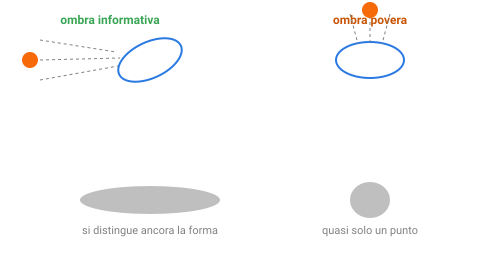

{:class="aside-image"}

### 11.1 L'ombra che racconta di più

Immagina di illuminare con una torcia un oggetto complicato, per esempio una chiave inglese, e di osservarne l'ombra proiettata su un muro. A seconda dell'angolo da cui arriva la luce, l'ombra può essere molto diversa: illuminata di lato, l'ombra è una sagoma allungata in cui si intuisce ancora la forma, il manico, la testa; illuminata proprio dall'estremità, l'ombra collassa in una macchia tonda quasi informe, da cui è impossibile intuire cosa sia l'oggetto. Stessa chiave inglese, stessa luce, ma un angolo produce un'ombra che conserva informazione, l'altro la butta via quasi tutta.

Questa lezione affronta un problema diverso da tutti quelli visti finora: non classificare, non prevedere un numero, non raggruppare, ma **scegliere il modo migliore di guardare i dati** quando le caratteristiche a disposizione sono troppe per essere gestite comodamente tutte insieme. La tecnica più diffusa per farlo si chiama **PCA**, sigla di *Principal Component Analysis* (analisi delle componenti principali), e la sua idea di fondo è sorprendentemente vicina all'ombra della chiave inglese: trovare l'angolo di proiezione che conserva più informazione possibile.

### 11.2 Quando le caratteristiche diventano troppe

Le lezioni precedenti hanno lavorato quasi sempre con poche caratteristiche per volta, il suono e il colore di un'anguria, il peso e l'età di una bicicletta. Nei problemi reali, però, le caratteristiche disponibili possono essere decine, centinaia, a volte migliaia: i risultati di dozzine di esami del sangue diversi per un singolo paziente, le migliaia di risposte a un questionario di gradimento, i pixel stessi di un'immagine.

Con così tante caratteristiche emergono diversi problemi pratici: diventa impossibile visualizzare i dati su un grafico (lo spazio delle caratteristiche della Lezione 2 avrebbe più di tre dimensioni, che nessuno riesce a disegnare), molti algoritmi diventano più lenti o meno affidabili, e spesso, fra tutte quelle caratteristiche, molte sono ridondanti, dicono più o meno la stessa cosa con parole diverse (il peso e il volume di un pacco, per esempio, tendono quasi sempre a crescere insieme). PCA affronta esattamente questo problema.

### 11.3 Cercare la direzione con più variazione

Il modo in cui PCA sceglie la sua "ombra migliore" è cercare, fra tutte le possibili direzioni lungo cui proiettare i dati, quella in cui i punti restano **il più possibile distanziati fra loro**, invece di ammassarsi tutti vicini. Un gruppo di punti che, proiettato lungo una certa direzione, resta ben distribuito, da un estremo all'altro, conserva molta dell'informazione originale su come i punti differiscono fra loro; un gruppo che, proiettato lungo un'altra direzione, si accalca quasi tutto nello stesso punto, ha perso quasi ogni capacità di distinguere un esempio dall'altro, esattamente come l'ombra tonda della chiave inglese.

<figure style="margin: 2rem 0; text-align: center;">
<svg viewBox="0 0 520 220" xmlns="http://www.w3.org/2000/svg" role="img" aria-labelledby="pca-title pca-desc" style="width: 100%; max-width: 480px; height: auto; font-family: inherit;">
  <title id="pca-title">Punti allineati proiettati su due direzioni diverse</title>
  <desc id="pca-desc">Un gruppo di punti allungato lungo una diagonale, con la proiezione sulla diagonale che resta ben distribuita, e la proiezione sulla direzione perpendicolare che si accalca in poco spazio.</desc>

  <rect x="20" y="20" width="220" height="180" rx="10" fill="#fdfdfd" stroke="#e3e3e3" stroke-width="1.5" />
  <line x1="45" y1="175" x2="215" y2="45" stroke="#2a7ae2" stroke-width="1.5" stroke-dasharray="4 3" />
  <g fill="#111"><circle cx="60" cy="165" r="5" /><circle cx="90" cy="140" r="5" /><circle cx="120" cy="115" r="5" /><circle cx="155" cy="85" r="5" /><circle cx="190" cy="60" r="5" /></g>
  <text x="130" y="205" fill="#828282" font-size="11" text-anchor="middle">dati originali (due caratteristiche)</text>

  <path d="M 260,110 L 340,110" stroke="#828282" stroke-width="1.5" marker-end="url(#pcaf)" />
  <defs><marker id="pcaf" markerWidth="8" markerHeight="8" refX="6" refY="4" orient="auto" markerUnits="userSpaceOnUse"><path d="M0,0 L8,4 L0,8 z" fill="#828282" /></marker></defs>

  <rect x="350" y="20" width="150" height="70" rx="8" fill="#eef2f7" stroke="#3aa655" stroke-width="1.5" />
  <line x1="365" y1="55" x2="485" y2="55" stroke="#3aa655" stroke-width="2" />
  <g fill="#3aa655"><circle cx="375" cy="55" r="4" /><circle cx="400" cy="55" r="4" /><circle cx="425" cy="55" r="4" /><circle cx="450" cy="55" r="4" /><circle cx="475" cy="55" r="4" /></g>
  <text x="425" y="78" fill="#111" font-size="10" text-anchor="middle">proiezione lungo la diagonale: ben distribuiti</text>

  <rect x="350" y="120" width="150" height="70" rx="8" fill="#fde8d6" stroke="#f66a0a" stroke-width="1.5" />
  <line x1="425" y1="135" x2="425" y2="175" stroke="#f66a0a" stroke-width="2" />
  <g fill="#f66a0a"><circle cx="425" cy="148" r="4" /><circle cx="425" cy="152" r="4" /><circle cx="425" cy="156" r="4" /><circle cx="425" cy="160" r="4" /><circle cx="425" cy="164" r="4" /></g>
  <text x="425" y="185" fill="#111" font-size="10" text-anchor="middle">proiezione perpendicolare: accalcati</text>
</svg>
<figcaption style="color: #828282; font-size: 0.9rem; margin-top: 0.5rem;">La direzione diagonale, la prima componente principale, conserva molta più informazione della direzione perpendicolare.</figcaption>
</figure>

La direzione che conserva più variazione possibile si chiama **prima componente principale**. PCA può poi cercare una seconda direzione, perpendicolare alla prima, che conserva la maggior parte della variazione rimasta, e così via, di solito con ogni nuova direzione trovata che cattura sempre meno informazione della precedente.

### 11.4 Comprimere senza perdere (troppo)

Una volta trovate queste direzioni, ordinate dalla più informativa alla meno informativa, PCA permette di **rappresentare gli stessi dati con meno numeri**, tenendo solo le prime componenti principali, quelle che catturano la maggior parte della variazione, e scartando le ultime, quelle che catturano poco più che rumore casuale. Un insieme di dati con cento caratteristiche originali potrebbe, per esempio, essere rappresentato quasi altrettanto bene con solo cinque o dieci componenti principali, se buona parte delle cento caratteristiche originali erano ridondanti o poco informative.

Questa compressione ha ricadute molto pratiche: rende possibile visualizzare su un grafico bidimensionale dati che originariamente vivevano in decine di dimensioni (tenendo solo le prime due componenti), e spesso accelera e persino migliora gli algoritmi delle lezioni precedenti, che lavorano più agevolmente con poche caratteristiche informative piuttosto che con centinaia di caratteristiche in parte ridondanti.

### 11.5 Cosa si perde per strada

Nessuna compressione è gratuita, ed è onesto chiudere questa lezione ricordandolo esplicitamente. Primo, scartare le componenti meno informative significa comunque perdere una parte, anche se di solito piccola, dell'informazione originale, un compromesso accettabile solo se quella parte scartata era davvero poco rilevante. Secondo, e forse più sottile, le componenti principali sono **combinazioni** delle caratteristiche originali, non più "il peso" o "il suono" presi singolarmente, ma un mescolamento matematico di entrambi: si guadagna compattezza, ma si perde l'interpretabilità diretta che caratteristiche come "peso" o "prezzo" avevano da sole.

Proprio per questo, PCA è uno strumento da usare con criterio, non un passaggio automatico da applicare sempre: quando tutte le caratteristiche originali portano informazione genuinamente diversa e importante, comprimerle può addirittura peggiorare le prestazioni di un modello, buttando via segnale utile insieme al rumore.

### 11.6 PCA in Python

Il programma cerca la prima componente principale di otto pacchi descritti da peso e volume, due caratteristiche ridondanti come quelle citate nel paragrafo 11.2. Per trovare la direzione usa un metodo a passi ripetuti, adatto a mostrare l'idea con poche righe. Dato che peso e volume hanno scale simili, non serve riportarli alla stessa scala, un accorgimento che altrimenti è di solito necessario.


# In tutto il programma un punto è una tupla (peso, volume) e una direzione
# è una tupla (x, y) lunga 1, per esempio (0.6, 0.8).

def centra(punti):
    """ Sposta la nuvola di punti in modo che il suo centro cada nell'origine:
    a ogni punto toglie la media delle x e la media delle y.
    parametro punti: list di tuple (x, y)
    return: list di tuple (x, y), i punti spostati
    Esempio: centra([(1, 2), (3, 6)]) restituisce [(-1.0, -2.0), (1.0, 2.0)]
    (il centro era (2, 4))
    """
    somma_x = 0
    somma_y = 0
    for punto in punti:
        somma_x = somma_x + punto[0]
        somma_y = somma_y + punto[1]
    media_x = somma_x / len(punti)
    media_y = somma_y / len(punti)
    centrati = []
    for punto in punti:
        centrati.append((punto[0] - media_x, punto[1] - media_y))
    return centrati

def covarianze(punti):
    """ Quanto varia ogni caratteristica (xx, yy) e quanto variano insieme (xy).
    parametro punti: list di tuple (x, y), già centrati
    return: tuple (xx, xy, yy) di float
    Esempio: covarianze([(-1, -2), (1, 2)]) restituisce (1.0, 2.0, 4.0)
    (xy è positivo: quando x cresce, cresce anche y)
    """
    xx = 0
    yy = 0
    xy = 0
    for punto in punti:
        x, y = punto
        xx = xx + x * x
        yy = yy + y * y
        xy = xy + x * y
    n = len(punti)
    return xx / n, xy / n, yy / n

def prima_componente(xx, xy, yy, giri):
    """ Parte da una direzione qualsiasi e la fa ruotare ripetutamente:
    a ogni giro si avvicina alla direzione in cui i punti variano di più.
    parametri xx, xy, yy: float, le covarianze restituite da covarianze
    parametro giri: int, quante volte ripetere la correzione, per esempio 100
    return: tuple (x, y), la direzione trovata, lunga 1
    Esempio: prima_componente(1.0, 2.0, 4.0, 100) restituisce circa (0.447, 0.894)
    (i punti (-1, -2) e (1, 2) stanno sulla retta che sale di 2 per ogni passo a destra)
    """
    x = 1.0
    y = 0.0
    for giro in range(giri):
        nuova_x = xx * x + xy * y
        nuova_y = xy * x + yy * y
        # Teniamo la direzione lunga 1: conta dove punta, non quanto è lunga.
        lunghezza = (nuova_x ** 2 + nuova_y ** 2) ** 0.5
        x = nuova_x / lunghezza
        y = nuova_y / lunghezza
    return x, y

def proietta(punto, direzione):
    """ L'ombra del punto lungo la direzione: un solo numero al posto di due.
    parametro punto: tuple (x, y)
    parametro direzione: tuple (x, y) lunga 1
    return: float
    Esempio: proietta((3, 4), (0.6, 0.8)) restituisce circa 5.0
    """
    return punto[0] * direzione[0] + punto[1] * direzione[1]

def varianza(valori):
    """ Quanto i valori si allontanano dallo zero, in media.
    I valori sono già centrati, quindi basta la media dei quadrati.
    parametro valori: list di numeri
    return: float
    Esempio: varianza([-1, 1, -3, 3]) restituisce 5.0
    """
    somma = 0
    for valore in valori:
        somma = somma + valore ** 2
    return somma / len(valori)

# Peso e volume di otto pacchi: due caratteristiche che crescono quasi insieme.
pacchi = [(1.0, 1.3), (2.1, 1.9), (3.0, 3.4), (3.9, 3.8),
          (5.2, 5.5), (6.1, 5.8), (7.0, 7.3), (8.1, 7.8)]

centrati = centra(pacchi)
xx, xy, yy = covarianze(centrati)

direzione = prima_componente(xx, xy, yy, 100)
# In due dimensioni la seconda componente è semplicemente la perpendicolare.
perpendicolare = (-direzione[1], direzione[0])

ombre = []
ombre_perpendicolari = []
for punto in centrati:
    ombre.append(proietta(punto, direzione))
    ombre_perpendicolari.append(proietta(punto, perpendicolare))

totale = varianza(ombre) + varianza(ombre_perpendicolari)
print("Prima componente:", (round(direzione[0], 3), round(direzione[1], 3)))
print("Variazione conservata dalla prima: " + str(round(100 * varianza(ombre) / totale, 1)) + "%")
print("Variazione lungo la perpendicolare: "
      + str(round(100 * varianza(ombre_perpendicolari) / totale, 1)) + "%")

# Ogni pacco è ora descritto da un solo numero invece che da due.
compressi = []
for ombra in ombre:
    compressi.append(round(ombra, 2))
print("Pacchi compressi:", compressi)


Eseguendo il programma si ottiene:


Prima componente: (0.719, 0.695)
Variazione conservata dalla prima: 99.6%
Variazione lungo la perpendicolare: 0.4%
Pacchi compressi: [-4.85, -3.64, -1.95, -1.02, 1.09, 1.95, 3.64, 4.78]


La direzione trovata è quasi la diagonale, e da sola conserva il 99,6% della variazione: possiamo descrivere ogni pacco con un solo numero perdendo pochissimo. Quel numero, però, non è più né il peso né il volume, ma un mescolamento dei due, esattamente il prezzo da pagare descritto nel paragrafo 11.5.

---

> **Prova tu, La direzione giusta**
>
> Cinque punti, ciascuno con due caratteristiche, formano quasi una linea diagonale: (1, 1), (2, 2), (3, 3), (4, 4), (5, 5).
>
> 1. Se dovessi descrivere questi cinque punti con **un solo numero** ciascuno, invece di due, lungo quale direzione (quella diagonale che li attraversa tutti, oppure quella perpendicolare) conserveresti quasi tutta l'informazione su come i punti si distinguono fra loro?
> 2. Perché, proiettando questi punti sulla direzione perpendicolare alla diagonale, si perderebbe quasi tutta l'informazione utile?
> 3. Immagina ora cinque punti diversi, sparsi più o meno a caso in un cerchio, senza nessuna direzione preferita: (2,5), (5,2), (4,6), (6,4), (3,3). Proveresti a comprimerli in una sola direzione con la stessa fiducia di prima? Cosa cambia rispetto al caso dei cinque punti allineati?

---

## Esercizi

1. Spiega con parole tue l'analogia dell'ombra della chiave inglese, e come si collega all'idea di trovare la direzione che conserva più informazione possibile.
2. Elenca un problema reale, diverso da quelli citati nel testo, in cui potresti avere decine o centinaia di caratteristiche, e spiega perché visualizzare quei dati su un grafico sarebbe altrimenti impossibile.
3. Spiega perché le componenti principali, una volta trovate, non sono più direttamente interpretabili come "il peso" o "il prezzo", ma diventano combinazioni di più caratteristiche originali.
4. Descrivi un caso in cui applicare PCA potrebbe peggiorare le prestazioni di un modello invece di migliorarle, collegandolo a quanto detto nella Sezione 11.5.
5. Immagina cinque caratteristiche molto correlate fra loro, per esempio altezza in centimetri, altezza in pollici, lunghezza del passo, lunghezza del braccio e taglia delle scarpe di un gruppo di persone. Spiega perché queste cinque caratteristiche potrebbero probabilmente essere compresse in una sola componente principale senza perdere quasi nessuna informazione.

---

*Continua con la [Lezione 12, Cosa finisce insieme nel carrello]({{ site.baseurl }}.html)*
