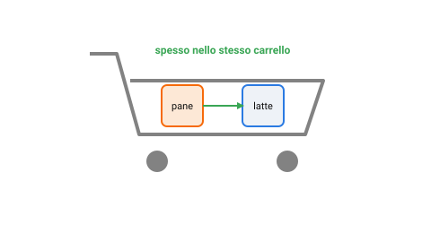

{:class="aside-image"}

### 12.1 Cosa finisce insieme nello stesso carrello

Un supermercato registra ogni giorno migliaia di scontrini, ciascuno con l'elenco dei prodotti comprati insieme in un solo carrello. Guardando questi scontrini nel loro insieme, spesso emergono combinazioni ricorrenti: chi compra pasta compra spesso anche il sugo pronto, chi compra una torta compra spesso anche le candeline. Nessuno ha bisogno di dirlo esplicitamente al sistema: la ricorrenza emerge da sola, contando semplicemente quante volte certi prodotti compaiono nello stesso scontrino.

Questa lezione affronta esattamente questo compito, trovare combinazioni di elementi che tendono a presentarsi insieme, con una famiglia di tecniche chiamata **regole di associazione** (in inglese *association rules*), spesso applicata proprio all'analisi del carrello della spesa (*market basket analysis*), da cui il nome. A differenza della classificazione o della regressione delle lezioni precedenti, qui non si vuole prevedere un'etichetta o un numero: si vuole scoprire quali combinazioni di elementi ricorrono più spesso del previsto.

### 12.2 Supporto: quanto è comune una combinazione

Il primo numero utile per valutare una combinazione di prodotti si chiama **supporto**: la frazione di tutti gli scontrini che contiene quella combinazione. Se su 10 scontrini totali, 5 contengono sia pane sia latte, il supporto della combinazione "pane e latte" è 5 su 10, cioè il 50%.

Il supporto misura semplicemente quanto è **comune** una combinazione, indipendentemente da qualunque relazione di causa: una combinazione con supporto altissimo potrebbe anche essere fatta di due prodotti che, semplicemente, compra praticamente chiunque, senza che l'uno abbia niente a che vedere con l'altro. Da solo, il supporto non basta a stabilire se una combinazione sia davvero interessante: serve un secondo numero.

### 12.3 Confidenza: quanto è affidabile la regola

Il secondo numero si chiama **confidenza**, e risponde a una domanda più mirata: fra tutti gli scontrini che contengono il primo prodotto (pane), quale frazione contiene anche il secondo (latte)? Si scrive come una regola, "chi compra pane, compra anche latte", e la confidenza è la percentuale di volte in cui questa regola si è rivelata vera negli scontrini osservati.

Per calcolarla basta dividere il supporto della combinazione completa per la frequenza del solo primo prodotto: se il pane compare in 7 scontrini su 10, e pane e latte insieme compaiono in 5 scontrini su 10, la confidenza della regola "pane implica latte" è 5 diviso 7, circa il 71%. Su cento clienti che comprano pane, circa 71 comprano anche latte.

### 12.4 Lift: la regola dice davvero qualcosa di nuovo?

Una confidenza del 71% sembra impressionante, a prima vista, ma nasconde una trappola che vale la pena smascherare subito con un esempio. Immagina che il latte, da solo, compaia già nel 70% di **tutti** gli scontrini, comprato da chiunque entri nel supermercato, con o senza pane. In quel caso, sapere che un cliente ha comprato pane non ha spostato quasi nulla la probabilità che compri anche latte: era già altissima in partenza, per tutti, pane o non pane.

Per smascherare situazioni come questa serve un terzo numero, il **lift**: il rapporto fra la confidenza della regola e la frequenza generale del secondo prodotto, presa da sola. Un lift vicino a 1 significa che la combinazione non dice quasi nulla di nuovo, il secondo prodotto sarebbe comparso comunque, pane o non pane; un lift molto maggiore di 1 significa che il primo prodotto aumenta davvero la probabilità del secondo, oltre quello che ci si aspetterebbe per puro caso; un lift minore di 1, infine, indica che i due prodotti tendono, se mai, a **escludersi** a vicenda, comparire insieme meno spesso del previsto.

<figure style="margin: 2rem 0; text-align: center;">
<svg viewBox="0 0 480 200" xmlns="http://www.w3.org/2000/svg" role="img" aria-labelledby="lift-title lift-desc" style="width: 100%; max-width: 440px; height: auto; font-family: inherit;">
  <title id="lift-title">Tre conteggi su dieci scontrini: pane, latte, e i due insieme</title>
  <desc id="lift-desc">Tre barre verticali che mostrano quanti scontrini su dieci contengono pane, quanti contengono latte, e quanti contengono entrambi insieme.</desc>

  <g font-size="11" fill="#111" text-anchor="middle">
    <rect x="60" y="60" width="60" height="120" fill="#fde8d6" stroke="#f66a0a" stroke-width="1.5" /><text x="90" y="195">pane: 7/10</text>
    <rect x="210" y="60" width="60" height="120" fill="#eef2f7" stroke="#2a7ae2" stroke-width="1.5" /><text x="240" y="195">latte: 7/10</text>
    <rect x="360" y="94" width="60" height="86" fill="#e6f4ea" stroke="#3aa655" stroke-width="1.5" /><text x="390" y="195">entrambi: 5/10</text>
  </g>
  <text x="240" y="24" fill="#828282" font-size="11" text-anchor="middle">pane e latte sono entrambi molto comuni da soli</text>
</svg>
<figcaption style="color: #828282; font-size: 0.9rem; margin-top: 0.5rem;">Con numeri così alti anche da soli, la combinazione dei due potrebbe non dire molto di più del caso.</figcaption>
</figure>

### 12.5 Dove si usano

Le regole di associazione restano lo strumento standard dietro molti sistemi di raccomandazione, "i clienti che hanno comprato questo hanno comprato anche...", nei negozi online, e dietro le decisioni di disposizione dei prodotti negli scaffali di un supermercato fisico, mettere vicini due prodotti con lift alto, non solo supporto alto, aumenta le probabilità che chi compra l'uno noti anche l'altro. Si applicano anche fuori dal commercio: quali pagine di un sito vengono visitate insieme nella stessa sessione, quali sintomi tendono a comparire insieme in una cartella clinica, quali errori software tendono a presentarsi in sequenza nello stesso log.

Il limite principale di questa famiglia di tecniche è che una regola trovata, per quanto statisticamente solida, resta comunque una **correlazione**, non necessariamente una spiegazione: sapere che pannolini e birra compaiono spesso nello stesso scontrino (un aneddoto famoso, vero o inventato che sia, nella storia di questo campo) non dice *perché* accade, solo che accade più spesso di quanto ci si aspetterebbe dal caso.

### 12.6 Le regole di associazione in Python

Il programma calcola supporto, confidenza e lift per tutte le regole fra coppie di prodotti, scartando le coppie troppo rare, e mostra per prime quelle con il lift più alto.


# In tutto il programma uno scontrino è una lista di prodotti, per esempio
# ["pasta", "sugo", "acqua"]. Negli esempi qui sotto usiamo quattro scontrini:
# [["pasta", "sugo"], ["pasta"], ["acqua"], ["pasta", "sugo"]]

def supporto(scontrini, prodotti):
    """ Frazione degli scontrini che contengono tutti i prodotti indicati.
    parametro scontrini: list di scontrini
    parametro prodotti: list di string
    return: float fra 0 e 1
    Esempio: supporto([["pasta", "sugo"], ["pasta"], ["acqua"], ["pasta", "sugo"]],
                      ["pasta", "sugo"]) restituisce 0.5
    (pasta e sugo sono insieme in 2 scontrini su 4)
    """
    quanti = 0
    for scontrino in scontrini:
        ci_sono_tutti = True
        for prodotto in prodotti:
            if prodotto not in scontrino:
                ci_sono_tutti = False
        if ci_sono_tutti:
            quanti = quanti + 1
    return quanti / len(scontrini)

def confidenza(scontrini, primo, secondo):
    """ Fra gli scontrini con il primo prodotto, quanti contengono anche il secondo.
    parametro scontrini: list di scontrini
    parametri primo, secondo: string, la regola "primo -> secondo"
    return: float fra 0 e 1
    Esempio: confidenza([["pasta", "sugo"], ["pasta"], ["acqua"], ["pasta", "sugo"]],
                        "pasta", "sugo") restituisce circa 0.667
    (la pasta è in 3 scontrini, e in 2 di questi c'è anche il sugo)
    """
    return supporto(scontrini, [primo, secondo]) / supporto(scontrini, [primo])

def lift(scontrini, primo, secondo):
    """ Confronta la confidenza con la frequenza generale del secondo prodotto:
    sopra 1 il primo prodotto rende il secondo più probabile, sotto 1 meno.
    parametro scontrini: list di scontrini
    parametri primo, secondo: string, la regola "primo -> secondo"
    return: float
    Esempio: lift([["pasta", "sugo"], ["pasta"], ["acqua"], ["pasta", "sugo"]],
                  "pasta", "sugo") restituisce circa 1.333
    (confidenza 0.667 diviso 0.5, perché il sugo è in metà degli scontrini)
    """
    return confidenza(scontrini, primo, secondo) / supporto(scontrini, [secondo])

def trova_regole(scontrini, supporto_minimo):
    """ Calcola supporto, confidenza e lift per tutte le regole fra due prodotti,
    scartando le coppie che compaiono insieme troppo di rado.
    parametro scontrini: list di scontrini
    parametro supporto_minimo: float, per esempio 0.2 per scartare le coppie
                               presenti in meno del 20% degli scontrini
    return: list di tuple (primo, secondo, supporto, confidenza, lift)
    Esempio: trova_regole([["pasta", "sugo"], ["pasta", "sugo"], ["pasta"], ["acqua", "pasta"]], 0.5)
             restituisce [("pasta", "sugo", 0.5, 0.5, 1.0), ("sugo", "pasta", 0.5, 1.0, 1.0)]
    (pasta e acqua sono insieme solo in uno scontrino su quattro, sotto il minimo,
    e la coppia viene scartata; il lift 1.0 dice che la pasta, presente in tutti
    gli scontrini, non rende il sugo né più né meno probabile)
    """
    # Raccoglie tutti i prodotti, senza doppioni.
    prodotti = []
    for scontrino in scontrini:
        for prodotto in scontrino:
            if prodotto not in prodotti:
                prodotti.append(prodotto)

    regole = []
    # Ogni coppia di prodotti diversi viene considerata una volta sola.
    for i in range(len(prodotti)):
        for j in range(i + 1, len(prodotti)):
            a = prodotti[i]
            b = prodotti[j]
            if supporto(scontrini, [a, b]) >= supporto_minimo:
                # "pasta implica sugo" e "sugo implica pasta" sono due regole diverse.
                for primo, secondo in [(a, b), (b, a)]:
                    regole.append((primo, secondo,
                                   supporto(scontrini, [primo, secondo]),
                                   confidenza(scontrini, primo, secondo),
                                   lift(scontrini, primo, secondo)))
    return regole

def ordina_per_lift(regole):
    """ Mette in cima le regole con il lift più alto: ogni regola viene aggiunta
    in fondo e fatta risalire finché quella prima non ha un lift almeno uguale.
    regola[4] è il lift.
    parametro regole: list di tuple (primo, secondo, supporto, confidenza, lift)
    return: list delle stesse regole, dal lift più alto al più basso
    Esempio: ordina_per_lift([("acqua", "caffè", 0.3, 0.37, 1.25),
                              ("pasta", "sugo", 0.4, 0.8, 2.0)])
             restituisce [("pasta", "sugo", 0.4, 0.8, 2.0),
                          ("acqua", "caffè", 0.3, 0.37, 1.25)]
    """
    ordinate = []
    for regola in regole:
        ordinate.append(regola)
        i = len(ordinate) - 1
        while i > 0 and ordinate[i - 1][4] < ordinate[i][4]:
            temp = ordinate[i]
            ordinate[i] = ordinate[i - 1]
            ordinate[i - 1] = temp
            i = i - 1
    return ordinate

def percentuale(frazione):
    """ Trasforma una frazione in una percentuale da stampare.
    parametro frazione: float fra 0 e 1
    return: string
    Esempio: percentuale(0.25) restituisce "25%"
    """
    return str(round(100 * frazione)) + "%"

# Ogni scontrino è una lista di prodotti: un prodotto c'è oppure non c'è.
scontrini = [
    ["pasta", "sugo", "acqua"],
    ["pasta", "sugo"],
    ["pasta", "sugo", "acqua", "caffè"],
    ["acqua", "caffè"],
    ["torta", "candeline", "acqua"],
    ["torta", "candeline"],
    ["pasta", "acqua"],
    ["acqua", "caffè", "torta"],
    ["sugo", "pasta", "acqua"],
    ["acqua", "candeline", "torta"],
]

# Il supporto minimo 0.2 scarta le coppie presenti in meno del 20% degli scontrini.
for regola in ordina_per_lift(trova_regole(scontrini, 0.2)):
    primo, secondo, sup, conf, lft = regola
    print(primo + " -> " + secondo + ": supporto " + percentuale(sup)
          + ", confidenza " + percentuale(conf) + ", lift " + str(round(lft, 2)))


Eseguendo il programma si ottiene:


candeline -> torta: supporto 30%, confidenza 100%, lift 2.5
torta -> candeline: supporto 30%, confidenza 75%, lift 2.5
pasta -> sugo: supporto 40%, confidenza 80%, lift 2.0
sugo -> pasta: supporto 40%, confidenza 100%, lift 2.0
caffè -> acqua: supporto 30%, confidenza 100%, lift 1.25
acqua -> caffè: supporto 30%, confidenza 37%, lift 1.25
pasta -> acqua: supporto 40%, confidenza 80%, lift 1.0
acqua -> pasta: supporto 40%, confidenza 50%, lift 1.0
sugo -> acqua: supporto 30%, confidenza 75%, lift 0.94
acqua -> sugo: supporto 30%, confidenza 37%, lift 0.94
acqua -> torta: supporto 30%, confidenza 37%, lift 0.94
torta -> acqua: supporto 30%, confidenza 75%, lift 0.94
acqua -> candeline: supporto 20%, confidenza 25%, lift 0.83
candeline -> acqua: supporto 20%, confidenza 67%, lift 0.83


La tabella mostra la trappola del paragrafo 12.4. La regola "pasta -> acqua" ha una confidenza dell'80%, che sembra alta, ma il suo lift è 1: l'acqua compare comunque nell'80% degli scontrini, quindi la regola non dice nulla di nuovo. "pasta -> sugo" ha la stessa confidenza, ma un lift di 2: comprare la pasta raddoppia davvero la probabilità di trovare il sugo nel carrello. Il lift è uguale nei due versi di una coppia, mentre la confidenza no.

---

> **Prova tu, Leggi dieci scontrini**
>
> Ecco dieci scontrini, ciascuno con i prodotti acquistati:
>
> | Scontrino | Prodotti |
> |---|---|
> | 1 | pane, latte |
> | 2 | pane, burro |
> | 3 | pane, latte, burro |
> | 4 | latte, uova |
> | 5 | pane, latte, burro |
> | 6 | pane, latte |
> | 7 | burro, uova |
> | 8 | pane, latte, burro |
> | 9 | latte |
> | 10 | pane, burro |
>
> 1. Su quanti scontrini compare il pane? Su quanti compare il latte? Su quanti compaiono entrambi insieme? Calcola il supporto della combinazione "pane e latte" (scontrini con entrambi, diviso il totale).
> 2. Calcola la confidenza della regola "chi compra pane, compra anche latte" (scontrini con entrambi, diviso scontrini con pane).
> 3. Confronta la confidenza trovata al punto 2 con la frequenza del latte da solo su tutti e dieci gli scontrini (indipendentemente dal pane). La regola "pane implica latte" ti sembra dire qualcosa di realmente nuovo, o il latte sarebbe comparso quasi altrettanto spesso comunque?

---

## Esercizi

1. Pensa a due prodotti, o due elementi qualsiasi, per esempio due app che usi spesso insieme, che secondo te avrebbero un supporto alto se qualcuno analizzasse i tuoi acquisti o le tue abitudini. Spiega perché.
2. Un negozio scopre che la regola "chi compra il caffè, compra anche i filtri di carta" ha una confidenza del 90%. Spiega quale altro numero dovresti conoscere prima di dire che questa regola è davvero interessante, e perché.
3. Spiega, con parole tue, cosa significa un lift vicino a 1, un lift molto maggiore di 1, e un lift minore di 1, usando un esempio a tua scelta per ciascun caso.
4. Perché una regola di associazione, per quanto statisticamente solida, non spiega necessariamente *perché* due prodotti compaiono spesso insieme? Fai un esempio in cui la vera spiegazione potrebbe essere diversa da quella più ovvia.
5. Immagina di gestire un negozio online: descrivi come useresti le regole di associazione per decidere quali prodotti "consigliati" mostrare a un cliente che ha appena messo nel carrello un paio di scarpe da corsa.

---

*Continua con la [Lezione 13, Il dato che non torna]({{ site.baseurl }}.html)*
